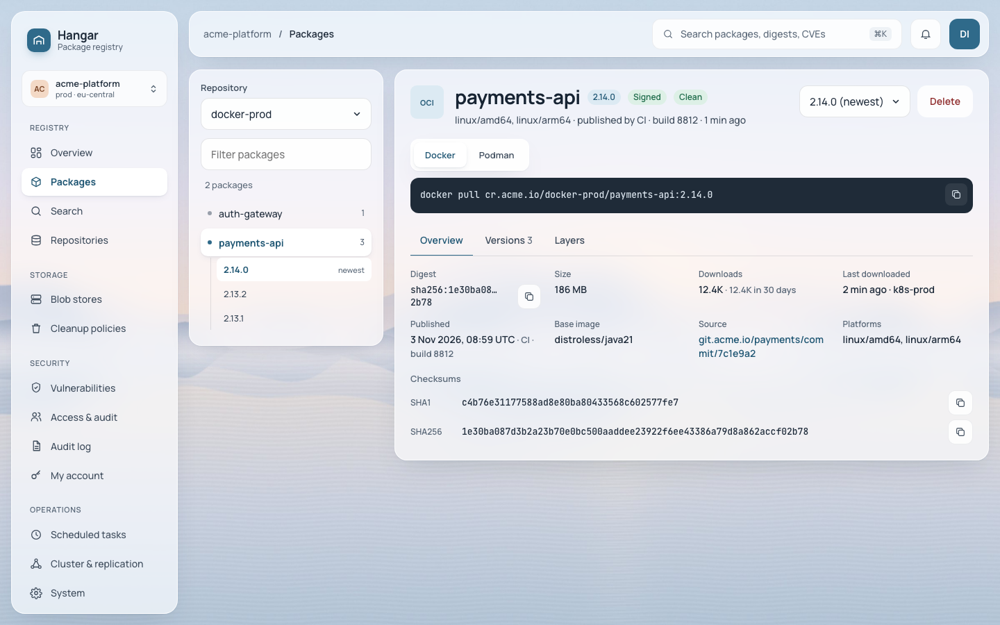
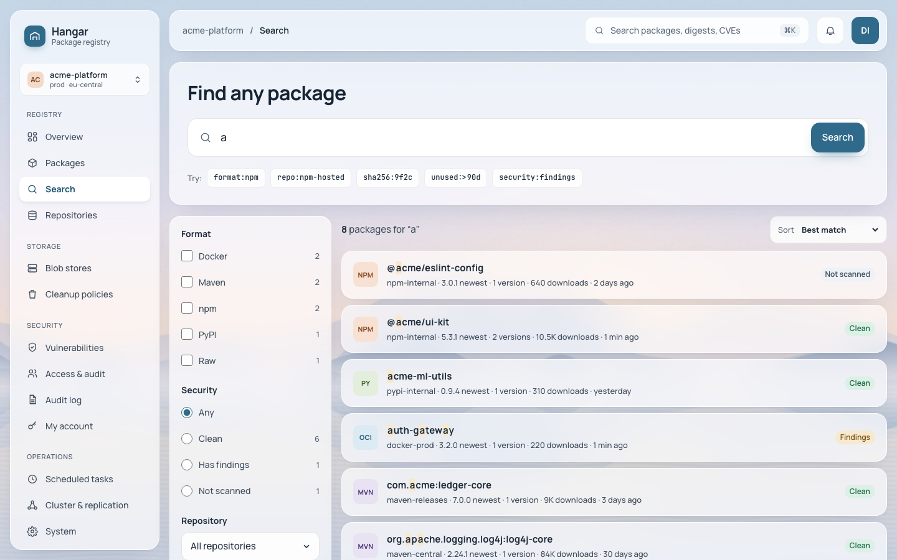
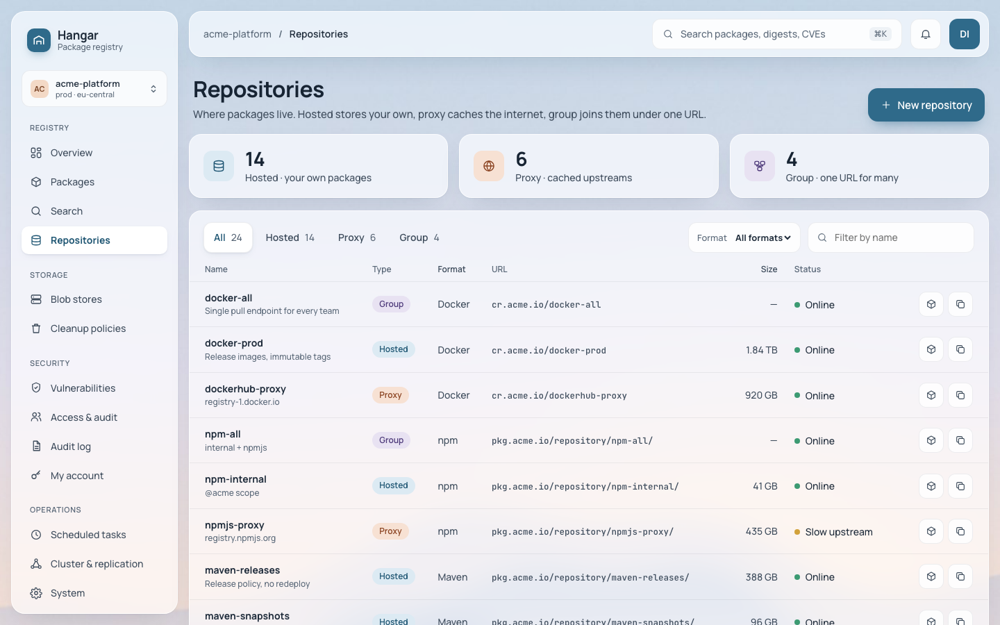
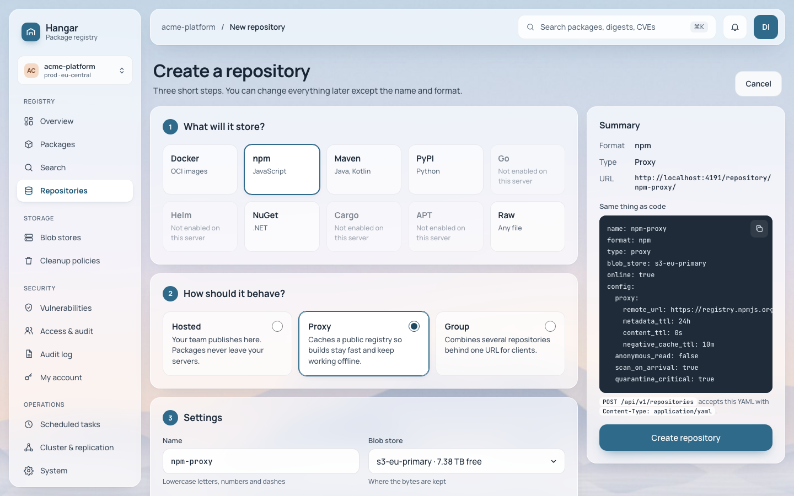
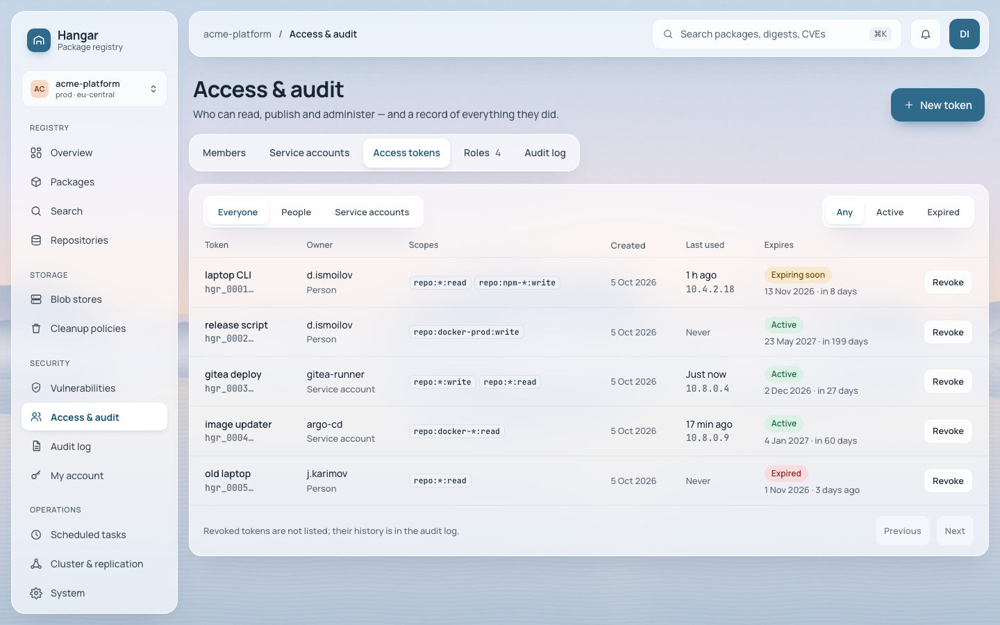
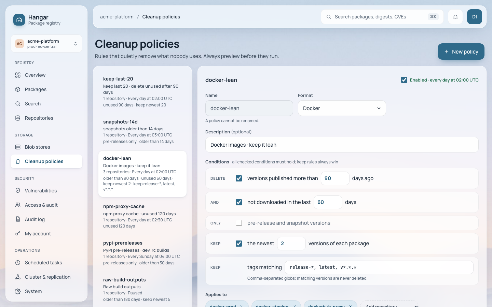
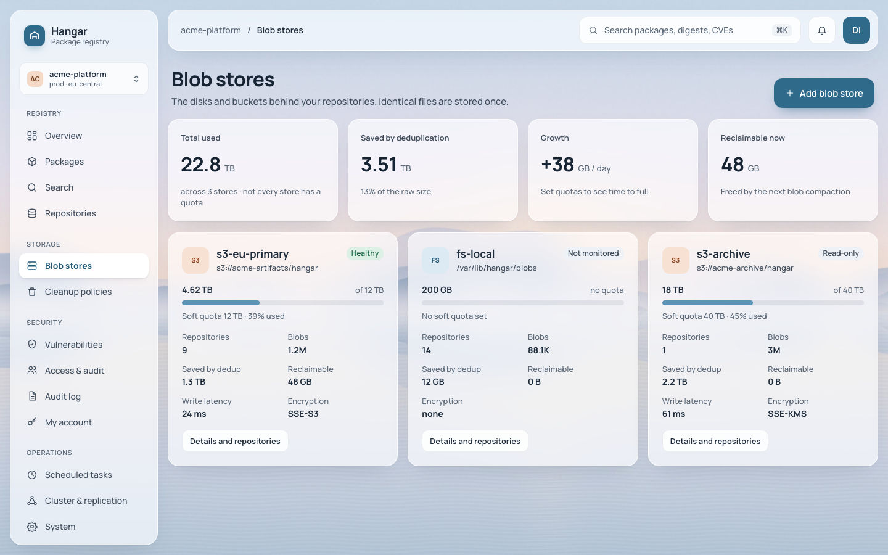

# Hangar

A self-hosted package registry for Docker, npm, Maven, PyPI, NuGet and raw files, in one Go binary backed by PostgreSQL.

[](go.mod)


## What it does

- **Formats:** Docker/OCI (including Helm charts and cosign signatures), npm, Maven/Gradle, PyPI, NuGet and raw files.
- **Repository types:** hosted (your own packages), proxy (a cache of a public registry) and group (several repositories behind one URL).
- **Access:** users, roles and scoped access tokens for people and CI, plus an audit log of every change and failed sign-in.
- **Cleanup policies:** delete old or unused versions on a schedule, with a preview before anything is removed.
- **Security:** every request needs sign-in unless a repository allows anonymous read; upstream credentials and S3 keys are encrypted in the database.
- **Observability:** Prometheus metrics, JSON logs, OpenTelemetry traces, Grafana dashboards and alert rules in [`deploy/observability`](deploy/observability).
- **Simple to run:** a single Go binary with the web UI built in, PostgreSQL for metadata, blobs on a filesystem or S3.

## Screenshots

| | |
|---|---|
|  |  |
| Package page with the install command, digest and checksums | Search across all repositories with filters |
|  |  |
| Hosted, proxy and group repositories | Creating an npm proxy, with the same settings as YAML |
|  |  |
| Access tokens with scopes and expiry | Cleanup policy editor |
|  | |
| Blob stores with usage and deduplication | |

## Quick start

On a Linux host with Docker and the Compose plugin, install the latest release
(published image, nothing is built on the server):

```bash
curl -fsSL https://raw.githubusercontent.com/ismoilovdevml/hangar/main/deploy/install.sh |
  sudo bash -s -- --domain hangar.example.com
```

The installer writes `/opt/hangar` (compose files and `.env` with generated
secrets), starts PostgreSQL and Hangar, waits until `/readyz` is ready and
prints the URL. The first administrator is `admin`; its password is in the
`.env` file (`sudo grep HANGAR_BOOTSTRAP_ADMIN_PASSWORD /opt/hangar/.env`).
Useful options:

- `--tls caddy --acme-email ops@example.com`: automatic HTTPS on ports 80/443.
- `--tls none --bind 0.0.0.0 --trusted-proxies 10.0.0.5/32`: behind your own
  reverse proxy (for example a company nginx that terminates TLS).
- `--version v0.1.0`: pin a release; re-run with a newer `--version` to upgrade.
- `--storage s3`: blobs in a bundled MinIO, or `--s3-endpoint` for external S3.

Back up `/opt/hangar/.env`: `HANGAR_SECRET_KEY` decrypts credentials stored in
the database. Other ways to install (Helm, systemd, manual compose), backups and
upgrades: [docs/deploy](docs/deploy/README.md). To run from source
(`go run ./cmd/hangar serve --migrate`) and for tokens and a first upload, see
the [getting started guide](docs/guides/getting-started.md).

## Use it from your tools

Replace `hangar.example.com` with your server and `<token>` with an access token.

Docker ([guide](docs/guides/docker.md)):

```bash
echo '<token>' | docker login hangar.example.com -u <user> --password-stdin
```

npm, `.npmrc` ([guide](docs/guides/npm.md)):

```ini
registry=https://hangar.example.com/repository/npm-group/
//hangar.example.com/repository/npm-group/:_authToken=${HANGAR_TOKEN}
```

pip ([guide](docs/guides/pypi.md)):

```bash
pip install --index-url https://__token__:<token>@hangar.example.com/repository/pypi-group/simple/ requests
```

NuGet ([guide](docs/guides/nuget.md)):

```bash
dotnet nuget add source https://hangar.example.com/repository/nuget-group/index.json \
  --name hangar --username token --password '<token>' --store-password-in-clear-text
```

Maven/Gradle, raw files and CI systems (GitLab CI, GitHub Actions, Jenkins, Gitea) are covered in the [guides](docs/guides/README.md).

## Documentation

- [User guides](docs/guides/README.md): clients, CI, access and the REST API
- [Deployment](docs/deploy/README.md): Docker Compose with automatic TLS, Helm chart, binary with systemd, backups, upgrades and high availability
- [Security](docs/security.md): hardening checklist and how secrets are stored; report vulnerabilities as described in [SECURITY.md](SECURITY.md)
- Operations: [monitoring](docs/operations/monitoring.md), [runbooks](docs/operations/runbooks.md), [performance](docs/operations/performance.md)
- [REST API reference](api/openapi.yaml) (OpenAPI)
- [Configuration example](hangar.example.yaml): every key can also be set as a `HANGAR_*` environment variable
- [Architecture](docs/ARCHITECTURE.md) and [changelog](docs/changelog.md)

## Development

Requires Go (see `go.mod`) and PostgreSQL 16 or newer; Node 22 or newer for the web UI in `web/`.

```bash
make dev     # start dependencies, the server and the web dev server
make test    # Go and web unit tests
make lint    # golangci-lint, eslint, tsc
make help    # everything else
```
