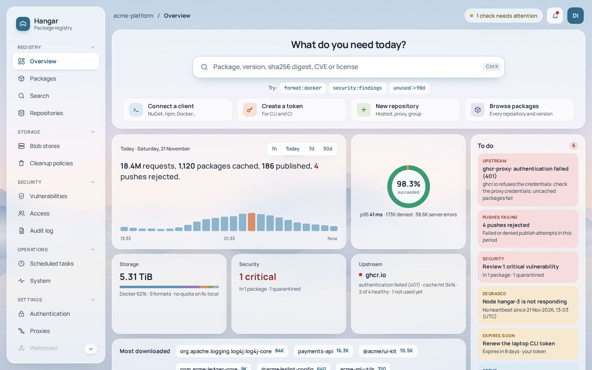
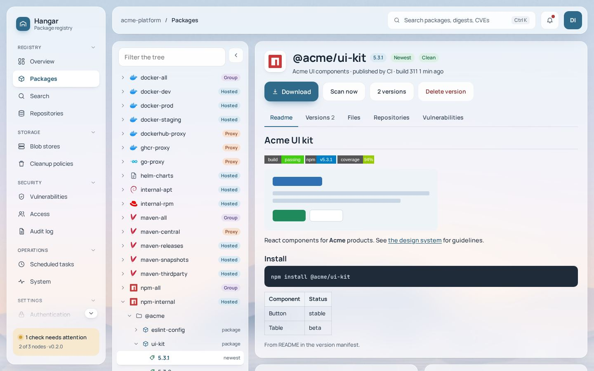
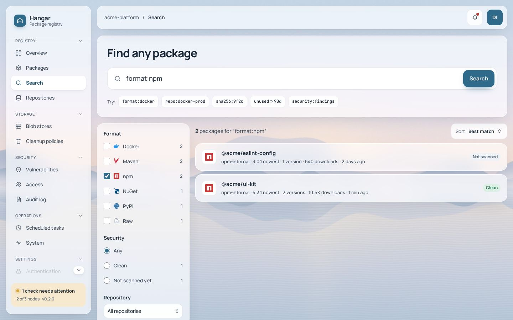
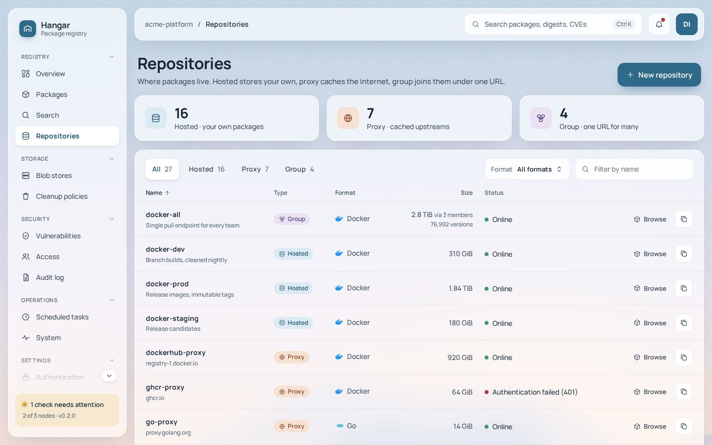
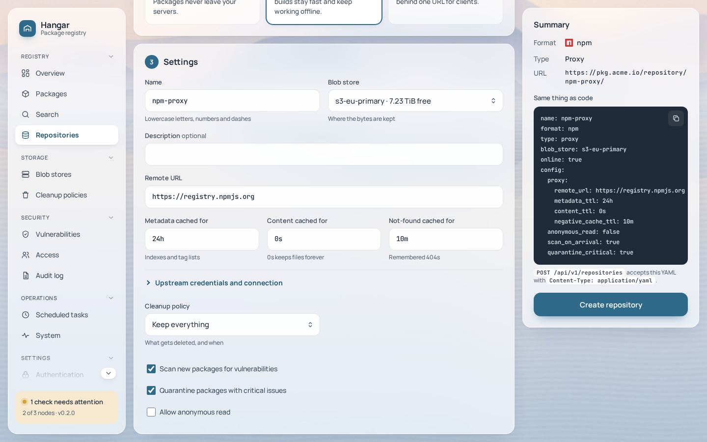
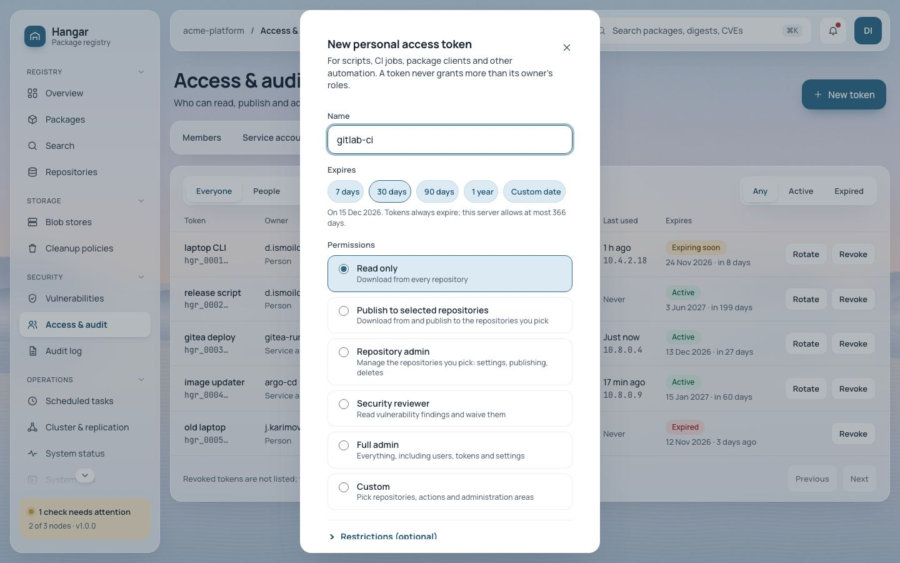
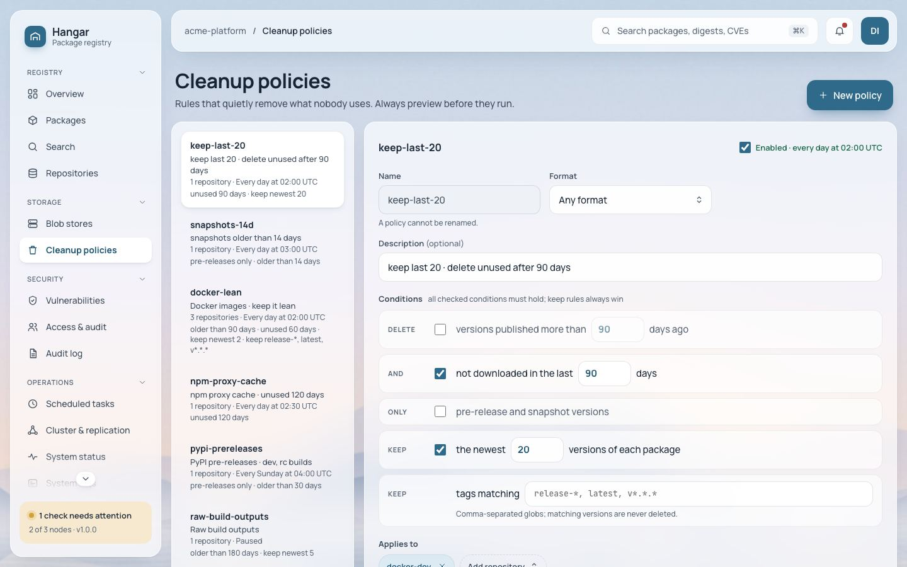
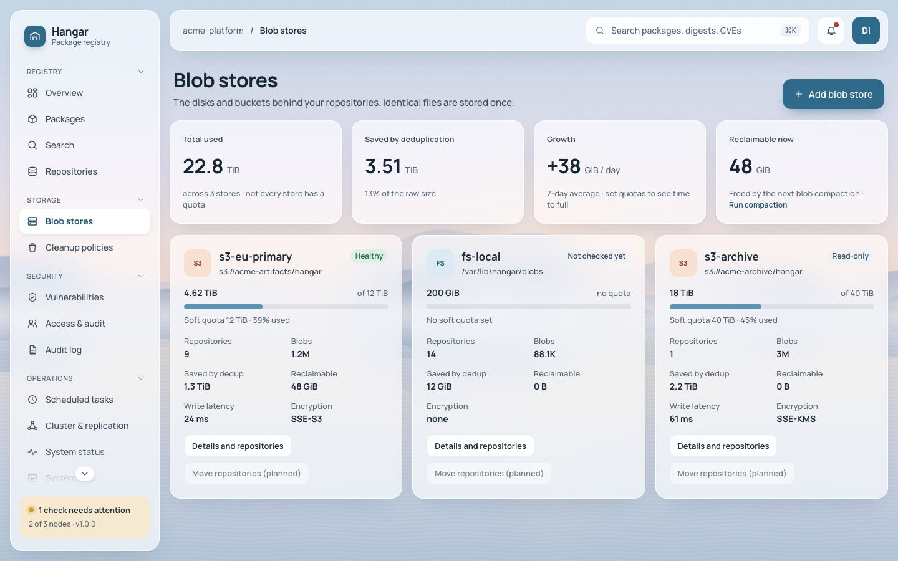
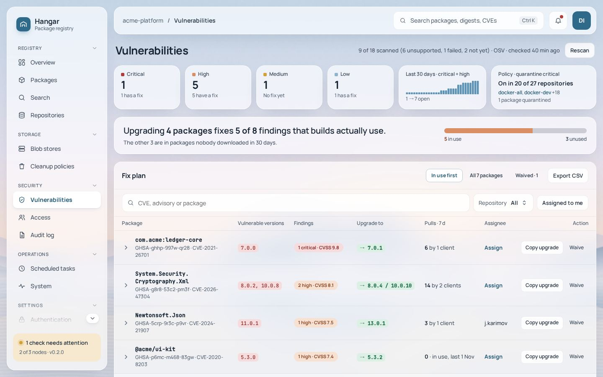

# Hangar

A self-hosted package registry for Docker, npm, Maven, PyPI, NuGet, Go modules, Helm charts, Cargo crates, APT and RPM packages and raw files, in one Go binary backed by PostgreSQL.

[](https://github.com/ismoilovdevml/hangar/releases/latest)
[](go.mod)

**[Website](https://ismoilovdevml.github.io/hangar/)** · **[Live demo](https://ismoilovdevml.github.io/hangar/demo/)** · **[Documentation](https://ismoilovdevml.github.io/hangar/docs.html)** · [Releases](https://github.com/ismoilovdevml/hangar/releases)



## What it does

- **Formats (11):** Docker/OCI (including OCI Helm charts and stored cosign signatures), npm, Maven/Gradle, PyPI, NuGet, Go modules, Helm chart repositories, Cargo, APT (Debian/Ubuntu), RPM (dnf/yum) and raw files. Each is tested with its real clients ([FORMATS.md](docs/FORMATS.md)).
- **Repository types:** hosted (your own packages), proxy (a cache of a public registry) and group (several repositories behind one URL).
- **Access:** users, roles and scoped access tokens for people and CI, plus an audit log of every change and failed sign-in.
- **Cleanup policies:** delete old or unused versions on a schedule, with a preview before anything is removed.
- **Security:** every request needs sign-in unless a repository allows anonymous read; upstream credentials and S3 keys are encrypted in the database; OIDC and LDAP sign-in; vulnerability scanning against OSV advisories and, for images, Trivy.
- **Observability:** Prometheus metrics, JSON logs, OpenTelemetry traces, Grafana dashboards and alert rules in [`deploy/observability`](deploy/observability).
- **Simple to run:** a single Go binary with the web UI built in, PostgreSQL for metadata, blobs on a filesystem or S3.

## Screenshots

| | |
|---|---|
|  |  |
| Package page with the install command, digest and checksums | Search across all repositories with filters |
|  |  |
| Hosted, proxy and group repositories | Creating an npm proxy, with the same settings as YAML |
|  |  |
| Creating an access token with a preset and expiry | Cleanup policy editor |
|  |  |
| Blob stores with usage and deduplication | Vulnerabilities with severity, trend and the fix plan |

## Quick start

On a Linux host with Docker and the Compose plugin:

```bash
curl -fsSL https://github.com/ismoilovdevml/hangar/releases/latest/download/install.sh | sudo bash
```

It asks for a data directory (default `/srv/hangar`) and an optional domain,
generates every secret, starts Hangar and PostgreSQL, and prints the URL, the
user `admin` and a one-time password. Re-run it to upgrade. Unattended
installs, TLS, moving an older `/opt/hangar` installation and uninstalling:
[install-compose.md](docs/deploy/install-compose.md). Other ways to install
(Helm, systemd), backups and upgrades: [docs/deploy](docs/deploy/README.md).
To run from source (`go run ./cmd/hangar serve --migrate`) and for tokens and
a first upload, see the [getting started guide](docs/guides/getting-started.md).

## Use it from your tools

Replace `hangar.example.com` with your server and `<token>` with an access token.

Docker ([guide](docs/guides/docker.md)):

```bash
echo '<token>' | docker login hangar.example.com -u <user> --password-stdin
```

npm, `.npmrc` ([guide](docs/guides/npm.md)):

```ini
registry=https://hangar.example.com/repository/npm-group/
//hangar.example.com/repository/npm-group/:_authToken=${HANGAR_TOKEN}
```

pip ([guide](docs/guides/pypi.md)):

```bash
pip install --index-url https://__token__:<token>@hangar.example.com/repository/pypi-group/simple/ requests
```

NuGet ([guide](docs/guides/nuget.md)):

```bash
dotnet nuget add source https://hangar.example.com/repository/nuget-group/index.json \
  --name hangar --username token --password '<token>' --store-password-in-clear-text
```

Maven/Gradle, Go, Helm, Cargo, APT, RPM, raw files and CI systems (GitLab CI, GitHub Actions, Jenkins, Gitea) are covered in the [guides](docs/guides/README.md).
What is done, partial and planned: [roadmap](docs/ROADMAP.md).

## Documentation

- [User guides](docs/guides/README.md): clients, CI, access and the REST API
- [Move to Hangar](docs/guides/migrate.md): import packages from another registry and pre-warm proxy caches
- [Deployment](docs/deploy/README.md): Docker Compose with automatic TLS, Helm chart, binary with systemd, backups, upgrades and high availability
- [Security](docs/security.md): hardening checklist and how secrets are stored; report vulnerabilities as described in [SECURITY.md](SECURITY.md)
- Operations: [monitoring](docs/operations/monitoring.md), [runbooks](docs/operations/runbooks.md), [performance](docs/operations/performance.md)
- [REST API reference](api/openapi.yaml) (OpenAPI)
- [Configuration example](hangar.example.yaml): every key can also be set as a `HANGAR_*` environment variable
- [Architecture](docs/ARCHITECTURE.md) and [changelog](docs/changelog.md)

## Development

Requires Go (see `go.mod`) and PostgreSQL 16 or newer; Node 22 or newer for the web UI in `web/`.

```bash
make dev     # start dependencies, the server and the web dev server
make test    # Go and web unit tests (needs HANGAR_TEST_DATABASE_URL)
make lint    # golangci-lint, eslint, tsc
make help    # everything else
```

Tests, the real-client e2e suite and Playwright: [CONTRIBUTING.md](CONTRIBUTING.md).
