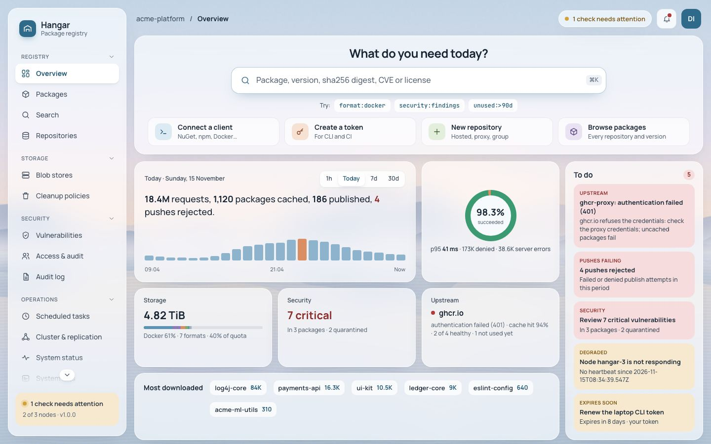

# Introduction

Hangar is a self-hosted package registry. It keeps every package your builds need in one place: what you publish, and cached copies of what you download.

## Why teams use it

- **Builds stop depending on the internet.** Once a package is cached, a public registry that is down no longer breaks CI: proxy repositories keep serving what they have.
- **One registry for eleven formats.** Docker/OCI, npm, Maven, PyPI, NuGet, Go modules, Helm, Cargo, APT, RPM and raw files share one sign-in, one set of roles and one audit log.
- **You see what is risky.** Packages are checked against [OSV](https://osv.dev) advisories and container images with Trivy. The fix plan shows what to upgrade first, and a repository can quarantine versions with critical findings.
- **It is small.** One Go binary with the web UI built in, PostgreSQL for metadata, and package files on a filesystem or in S3. No JVM.

## Where to go next

- [**Getting started**](/docs/guides/getting-started/): From nothing to a working repository, a token and a first upload.
- [**Install**](/docs/deploy/): The install script (Docker Compose), Helm on Kubernetes, or the binary with systemd.
- [**Core concepts**](/docs/guides/#concepts-in-one-minute): Hosted, proxy and group repositories, URLs and credentials.
- [**Configuration**](/docs/deploy/#configuration-in-one-paragraph): hangar.yaml, HANGAR_* variables and secret files.

## Find your way around the docs

- [**Using the UI**](/docs/ui/): Every page of the web UI, with screenshots from the live demo.
- [**Package formats**](/docs/guides/docker/): Client set-up and publishing for Docker, npm, Maven, PyPI, NuGet, Go, Helm, Cargo, APT, RPM and raw.
- [**Move to Hangar**](/docs/guides/migrate/): Import packages from another registry and pre-warm the proxies.
- [**Operations**](/docs/security/): Security hardening, monitoring, alert runbooks and performance.

> **Source on GitHub.** The code, issues, changelog and roadmap are in [ismoilovdevml/hangar](https://github.com/ismoilovdevml/hangar). Bug reports and pull requests are welcome.
