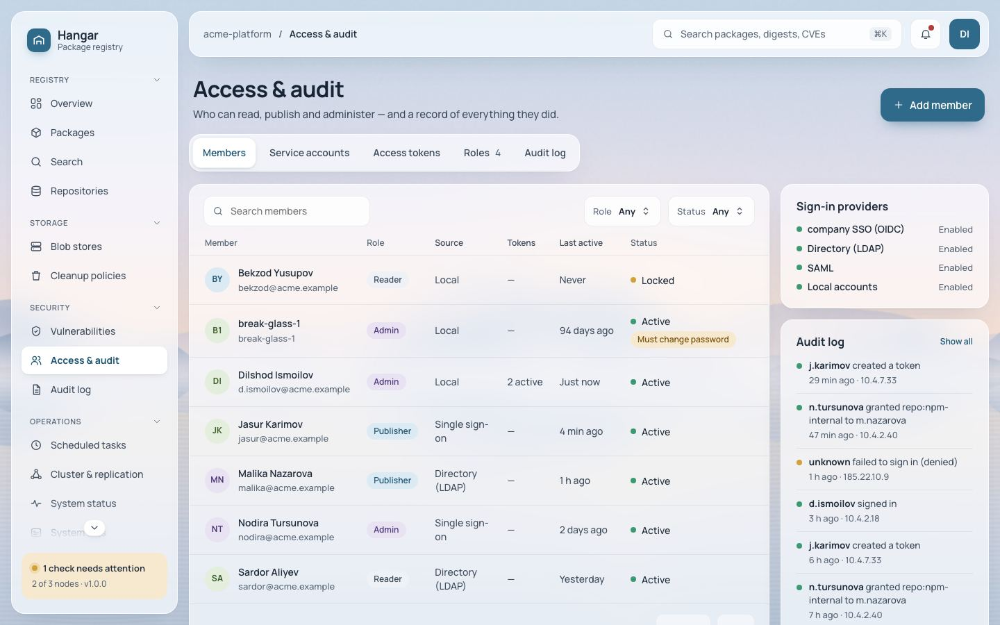
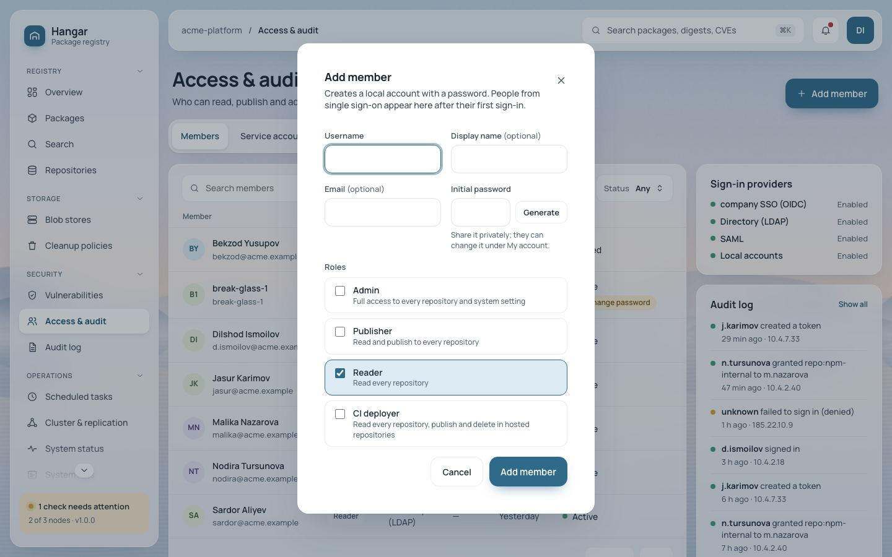
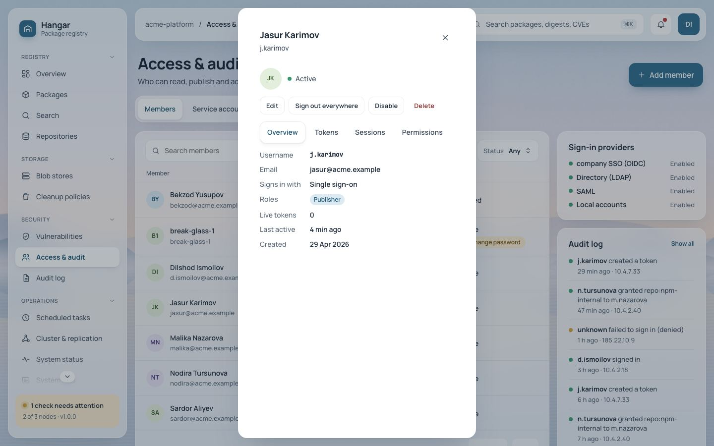
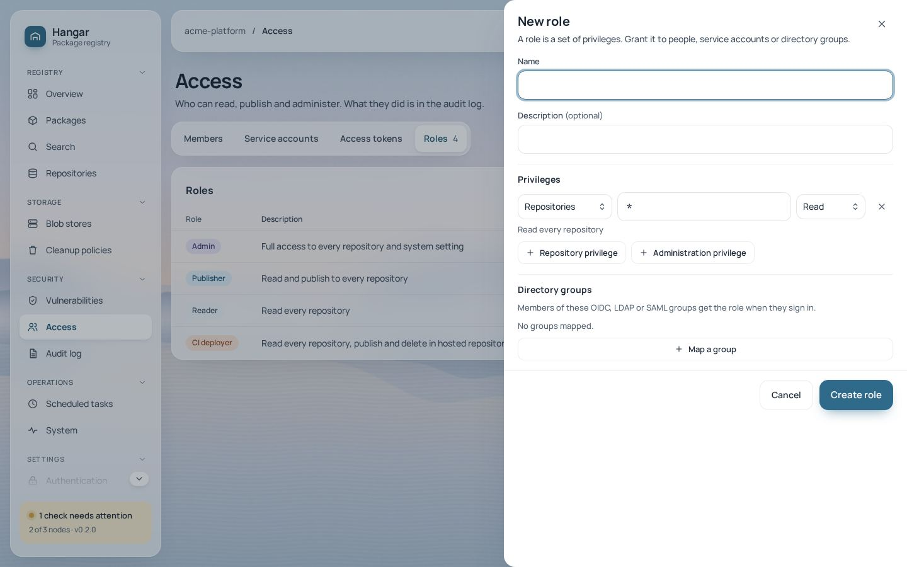
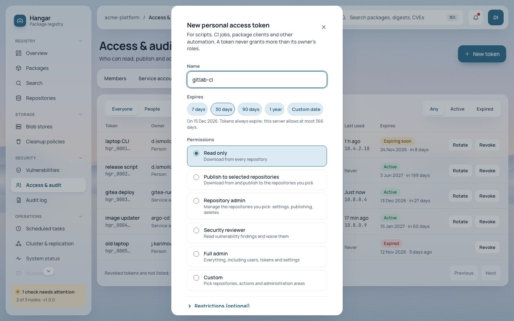
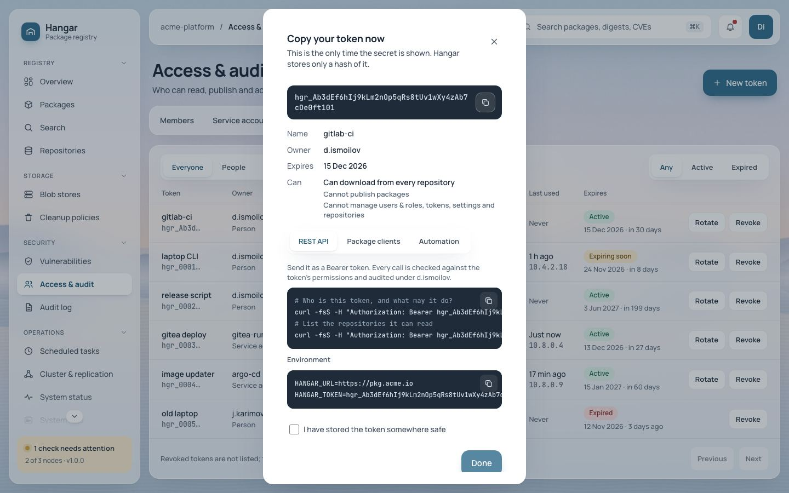

# Access & tokens

Add people, give them roles, set up service accounts for CI and create access tokens.

Open **Access & audit**. The tabs are **Members**, **Service accounts**, **Access tokens**, **Roles** and **Audit log**.

[Try it in the demo](/demo/#/access)

## Add a member

1. **Open the form**

    On **Members**, click **Add member**.

2. **Fill in the account**

    Enter a **Username**, and optionally a display name and email. Type an **Initial password** or click **Generate**; guessable passwords are refused. Share it privately; they can change it under **My account**.

3. **Pick roles**

    The built-in roles are **Admin** (everything), **Publisher** (read and publish to every repository), **Reader** (read every repository) and **CI deployer** (read every repository, publish and delete in hosted ones). **Reader** is selected by default.

    

4. **Save**

    Click **Add member**.

People who sign in with single sign-on or LDAP need no account here: they appear on their first sign-in, with the roles their directory groups map to ([Settings → Authentication](/docs/ui/settings/)).

[Try it in the demo](/demo/#/access)

## Manage a member

Click a member to open their panel: **Edit**, **Sign out everywhere**, **Disable** and **Delete**, with tabs for **Overview**, **Tokens**, **Sessions** and **Permissions**.

## Create a role

1. **Open Roles**

    On the **Roles** tab, click **New role**.

2. **Name it and add privileges**

    Enter a **Name**. Each privilege has **Applies to**, a repository name or pattern (`npm-*`) and an **Action**. Add more with **Repository privilege** or **Administration privilege**.

3. **Map directory groups**

    Under **Directory groups**, **Map a group** gives the role to members of an OIDC, LDAP or SAML group when they sign in.

    

4. **Save**

    Click **Create role**. Grant it in a member's or service account's panel.

[Try it in the demo](/demo/#/access?tab=roles)

## Set up a service account for CI

1. **Create it**

    On **Service accounts**, click **New service account**. Enter a **Name** and, optionally, **What uses it** (for example GitLab runners). **CI deployer** is selected; click **Create service account**.

2. **Give it a token**

    Click the account and create a token in its panel, one per pipeline, with only the repositories and actions it needs. Service accounts have no password.

[Try it in the demo](/demo/#/access?tab=service-accounts)

## Create an access token

Tokens are for package clients, CI jobs and scripts. A token never grants more than its owner's roles.

1. **Open the form**

    Click **New token** on the **Access tokens** tab, or in **My account → Personal access tokens**, or **Create a token** on the Overview.

2. **Name and expiry**

    Enter a **Name** such as `gitlab-ci`. Under **Expires**, pick 7 days, 30 days, 90 days, 1 year or a custom date. Tokens always expire.

3. **Permissions**

    Pick a preset: **Read only**, **Publish to selected repositories**, **Repository admin**, **Security reviewer**, **Full admin** or **Custom**. Under **Restrictions (optional)**, make it read-only or limit it to IP addresses and CIDR networks.

    

4. **Copy it now**

    Click **Create token**. **Copy your token now** shows the secret once, at the top, with its copy button ready; Hangar stores only a hash. The tabs show how to use it with the **REST API**, **Package clients** or **Automation**. Tick **I have stored the token somewhere safe** and click **Done**; closing before that asks first.

    

The **Access tokens** tab lists every token with its owner, last use and expiry. **Rotate** issues a new secret; **Revoke** ends it now.

[Try it in the demo](/demo/#/access?tab=tokens)
