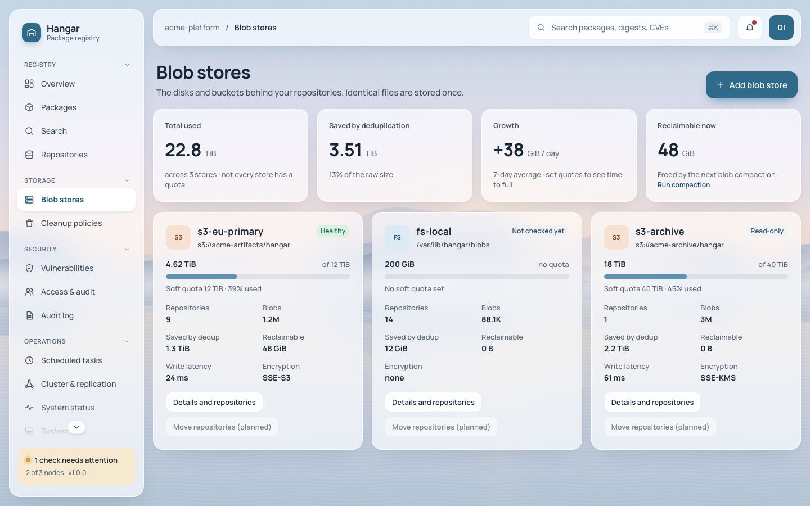
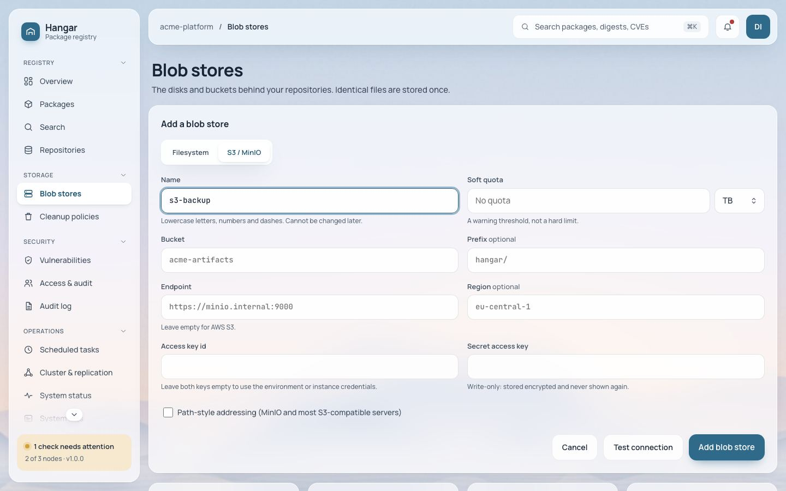
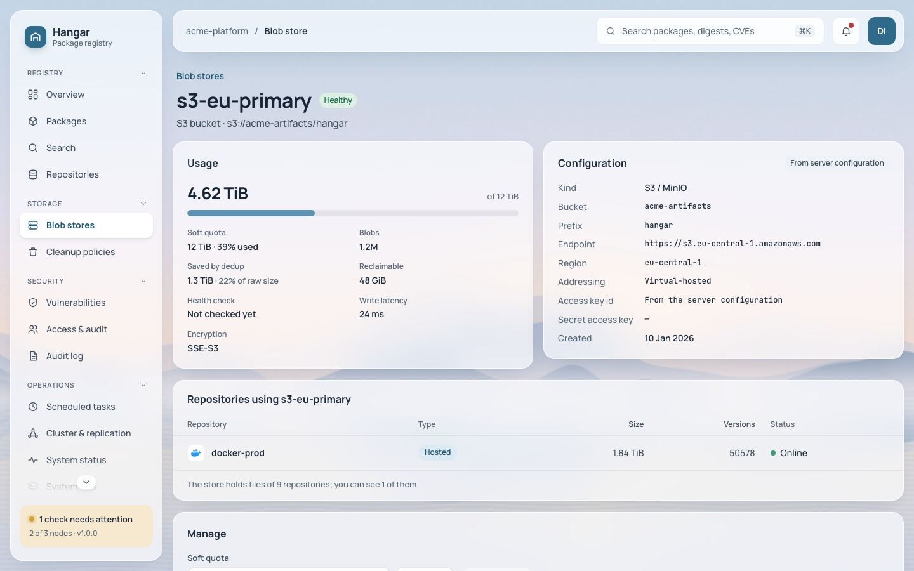

# Blob stores

The disks and buckets behind your repositories. Identical files are stored once.

## Read the page

Open **Blob stores**. The totals show **Total used**, **Saved by deduplication**, **Growth** and **Reclaimable now** (freed by the next blob compaction). **Run compaction** frees that space now. Each store's card shows its state, usage against its soft quota, repositories, blobs and write latency.

[Try it in the demo](/demo/#/blob-stores)

## Add a blob store

1. **Open the form**

    Click **Add blob store**.

2. **Pick the kind**

    **Filesystem** needs a **Directory on the server**. **S3 / MinIO** needs a **Bucket**, and optionally a **Prefix**, an **Endpoint** (empty for AWS S3) and a **Region**.

3. **Name and quota**

    Enter a **Name**; it cannot be changed later. **Soft quota** is a warning threshold, not a hard limit.

4. **Credentials**

    For S3, enter an **Access key id** and **Secret access key**, or leave both empty to use the environment or instance credentials. Check **Path-style addressing** for MinIO and most S3-compatible servers.

    

5. **Test and save**

    **Test connection** checks the bucket (write, read, delete) without saving and names the S3 error if one step fails. **Add blob store** runs the same test first; **Add anyway** saves a store that failed it. Pick the store as the **Blob store** when you create a repository; a repository cannot move to another store later.

[Try it in the demo](/demo/#/blob-stores?add=true)

## One store in detail

Click a store, or **Details and repositories**, for its usage, configuration, the repositories that use it and the **Manage** section (soft quota and more). An S3 store added in the UI has **Edit connection** for its credentials, region and path style; the store from the server configuration says so and shows the settings in effect.

[Try it in the demo](/demo/#/blob-stores/s3-eu-primary)

Sizing, S3 settings and backups: [Storage & cleanup](/docs/deploy/requirements/).
