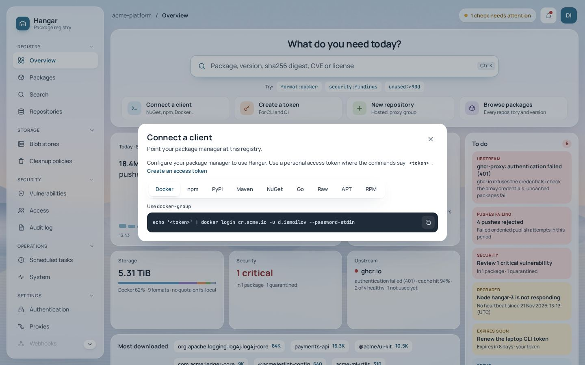

# Connect a client

Hangar writes the set-up commands for your package manager. You only add a token.

1. **Create a token**

    Clients authenticate with a personal access token, or a service account's token in CI. See [Access & tokens](/docs/ui/access/). **Read only** is enough to install packages.

2. **Open Connect a client**

    On the Overview, click **Connect a client**. The dialog has one tab per format on this server (Docker, npm, PyPI, Maven, NuGet, Go, Raw, APT, RPM and so on). Each uses the format's group, or a proxy when there is no group, or else a hosted repository.

    

3. **Copy and run**

    Click the copy button, paste into a terminal and replace `<token>` with your token.

4. **For one repository**

    Every repository has its own commands: open its settings and look at the **Summary** (**Connect a client** and **Publish**), or select it under **Packages** (**Use this repository**).

[Try it in the demo](/demo/#/)

The format guides explain each client in detail: [Docker & OCI](/docs/guides/docker/), [npm](/docs/guides/npm/), [NuGet](/docs/guides/nuget/), [Maven & Gradle](/docs/guides/maven/), [PyPI](/docs/guides/pypi/), [Go modules](/docs/guides/go/), [Helm charts](/docs/guides/helm/), [Cargo](/docs/guides/cargo/), [APT](/docs/guides/apt/), [RPM](/docs/guides/rpm/), [Raw files](/docs/guides/raw/).
