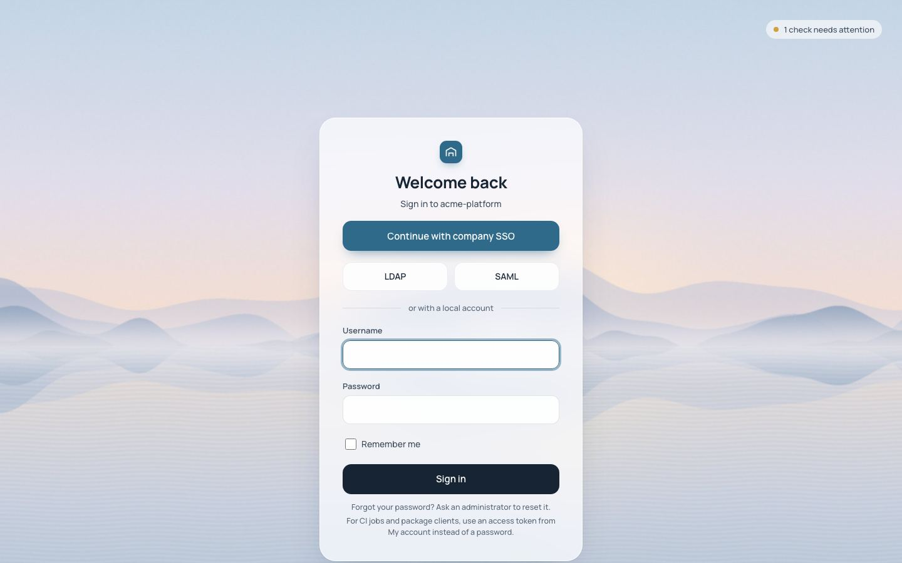
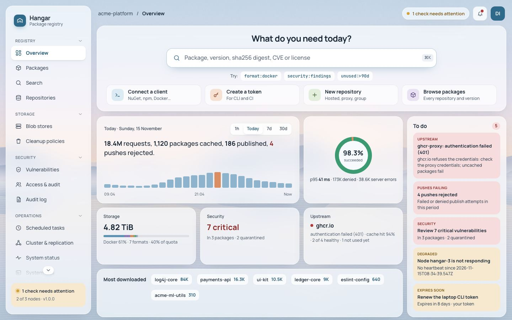
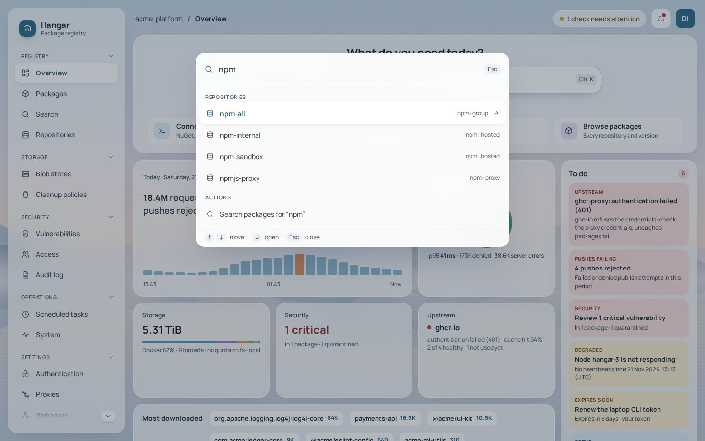

# The web UI

Every page of the web UI, step by step. Each screenshot comes from the live demo: the real UI with sample data, where you can click everything and nothing is kept after a reload.

> **Open the demo next to this guide.** [Live demo](/demo/). It starts signed in as an administrator. Every page below has a *Try it in the demo* link that opens the same screen.

## Sign in

Open the address the installer printed. Sign in with a username and password, or with the single sign-on buttons (**Continue with …**, **LDAP**, **SAML**) once an administrator has set them up under [Settings → Authentication](/docs/ui/settings/). The first administrator is `admin` with the one-time password from the installer; Hangar asks for a new password on the first sign-in. If your session ends while you work, Hangar asks for your password in place, so unsaved edits survive.

[Try it in the demo (any username, e.g. demo / demo)](/demo/#/login)

## Find your way around

The sidebar groups the pages:

| Group | Pages |
| --- | --- |
| Registry | **Overview**, **Packages**, **Search**, **Repositories** |
| Storage | **Blob stores**, **Cleanup policies** |
| Security | **Vulnerabilities**, **Access & audit**, **Audit log** |
| Operations | **Scheduled tasks**, **Cluster**, **System status**, **System logs** |
| Settings | **Settings**, **Authentication**, **Proxies** |

You see only the pages your roles allow; the sections fold, so every entry stays reachable on a laptop screen. The top bar shows where you are, a status pill when something needs attention, your notifications and the account menu with **My account** and **Sign out**. Times are shown in your local time with the zone, for example `14:05 (UTC+5)`, and sizes in binary units (GiB, TiB).

## Read the Overview

[Try it in the demo](/demo/#/)

1. **Ask a question**

    Type in **What do you need today?**: a package name, a version, a sha256 digest, a CVE or a license. The chips below it (`format:docker`, `security:findings`, `unused:>90d`) show the [search syntax](/docs/ui/packages/).

2. **Start a common task**

    The four cards open **Connect a client**, **Create a token**, **New repository** and **Browse packages**.

3. **Pick a time range**

    **1h**, **Today**, **7d** or **30d** changes the activity sentence (requests, packages cached, published, pushes rejected), the chart and the success rate.

4. **Work through To do**

    **To do** lists only what needs a person: a failing upstream, rejected pushes, critical vulnerabilities, a token that expires soon. Click an item to go where it is fixed. The cards below show storage, security and upstream health and open their pages too.

## Jump anywhere with ⌘K

Press <kbd>⌘</kbd> <kbd>K</kbd> (<kbd>Ctrl</kbd> <kbd>K</kbd> on Linux and Windows) on any page, or click the search box in the top bar. Type the name of a page, a repository, a package or a user, or an advisory id such as `CVE-2021-44228`. A matching page ranks first and <kbd>Enter</kbd> opens it; the last option searches every package.

## Next

- [**Repositories**](/docs/ui/repositories/): Create hosted, proxy and group repositories.
- [**Connect a client**](/docs/ui/connect/): Point docker, npm or pip at Hangar.
- [**Access & tokens**](/docs/ui/access/): Add people, roles and CI tokens.
