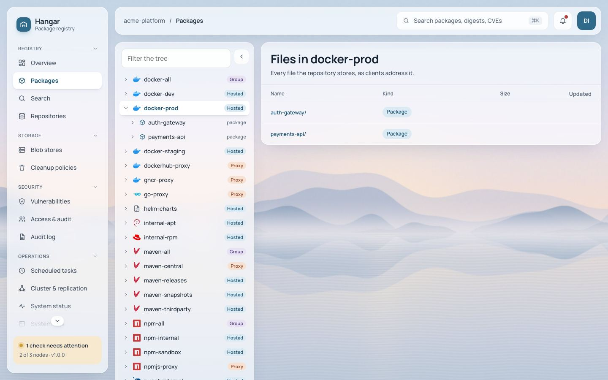
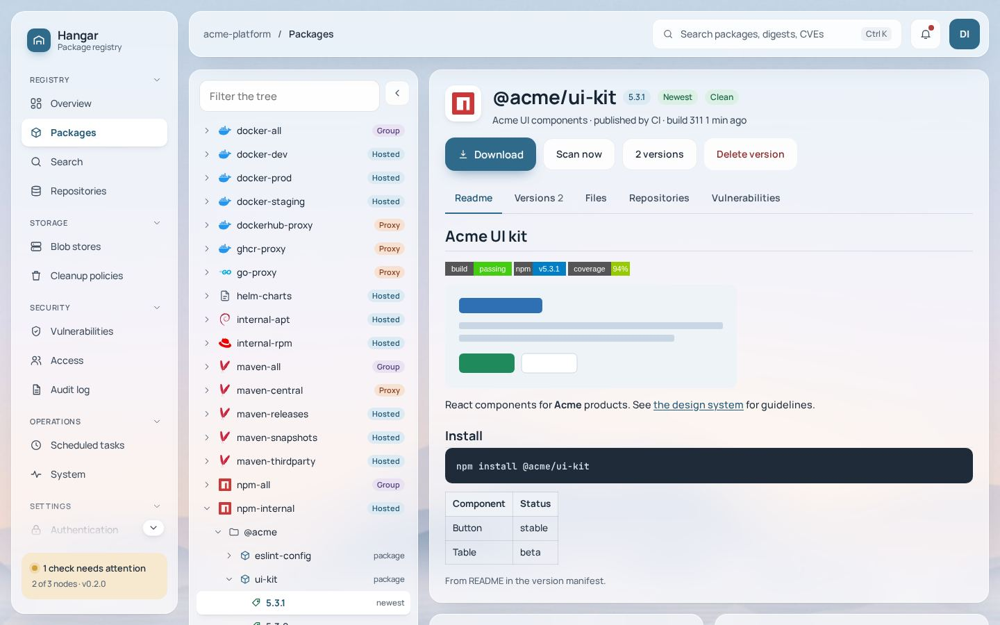
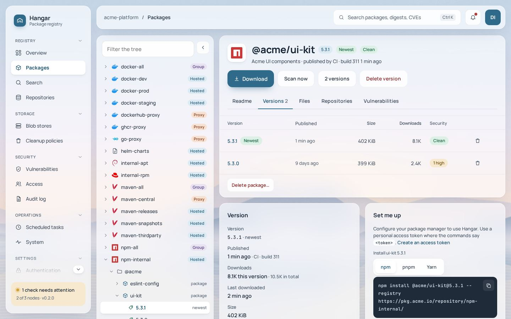
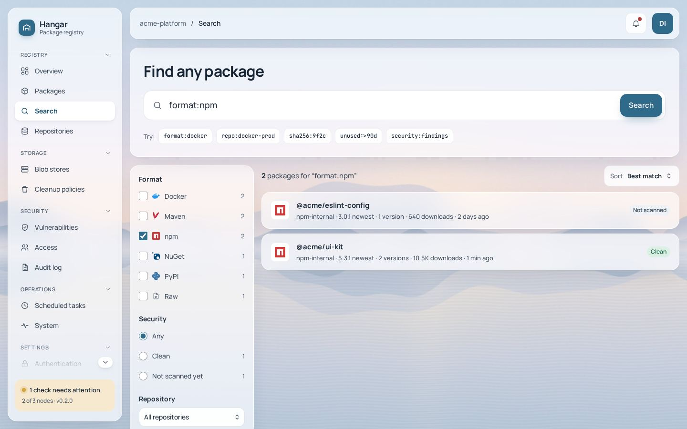

# Packages & search

Browse every repository, package, version and file, or search across all of them.

## Browse

1. **Open Packages**

    The tree on the left lists every repository you can read, as repository, package, version. **Filter the tree** narrows it by name and links to a search of every package; **Hide the repository tree** gives the page the full width.

2. **Pick a repository**

    Its page shows type, format, status, size, version count, blob store and URL, and **Use this repository** has the set-up and publish commands for its client. **Files** lists every file the repository stores, as clients address it.

    

3. **Open a package version**

    Expand the repository (and a scope or group id, where the format has one), then a package: its versions are listed newest first, from every member of a group. Click a version. The tabs show **Readme**, **Versions**, **Files** (**Layers** for a Docker image), **Repositories** (where else it is stored) and **Vulnerabilities**. The **Version** card has publish date, downloads, size, licence and digest, and **Set me up** has the install command for each client.

    

4. **Download, scan or delete**

    **Download** fetches the main file and **Scan now** checks the version against the advisories again. **Delete version** removes this version, if your role allows. On the **Versions** tab, each row has a delete button, and **Delete package…** removes every version after you type the package name. Freed files are released at the next compaction.

    

[Try it in the demo](/demo/#/browse?repo=npm-internal&ns=%40acme&name=ui-kit&version=5.3.1)

## Search

Open **Search**, or press <kbd>/</kbd> to jump to the search box. Words match the start of any part of a package name. Add qualifiers to narrow the results; repeated qualifiers of the same kind mean “any of”.

| Qualifier | Finds |
| --- | --- |
| `format:npm` | Packages of one format |
| `repo:npm-hosted` | Packages in one repository |
| `sha256:9f2c` | Files whose digest starts with these 4 to 64 hex digits |
| `cve:CVE-2021-44228` | Versions affected by an advisory |
| `license:MIT` | Licence (`*` works as a wildcard) |
| `security:findings` | `pending`, `clean`, `findings` or `quarantined` |
| `unused:>90d` | Not downloaded for that long (h, d, w) |
| `published:<2026-01-01` | Published before, after or on a date |

A pasted advisory id (`CVE-…`, `GHSA-…`, `PYSEC-…`, `RUSTSEC-…`) searches as `cve:`, and a bare hex word of 8 to 64 digits matches a digest prefix or a package name. The filters on the left (**Format**, **Security**, **Repository**) and **Sort** refine the list. Click a result to open it in Packages.

[Try it in the demo](/demo/#/search?q=format%3Anpm)
