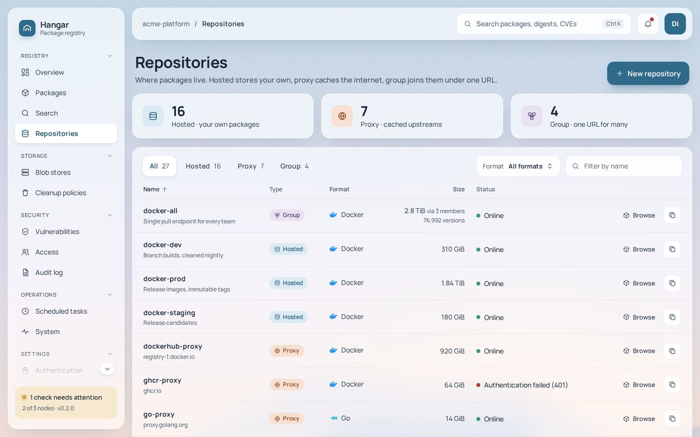
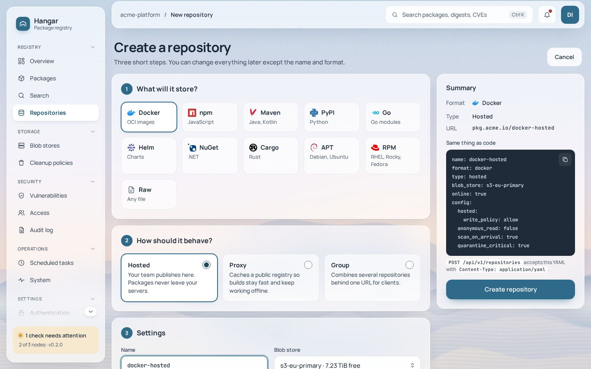
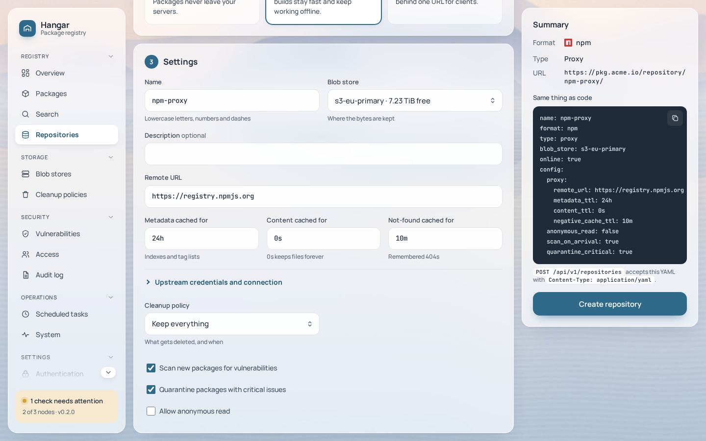
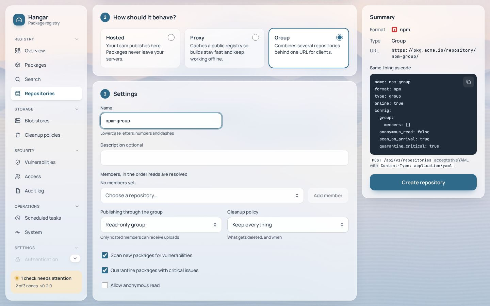
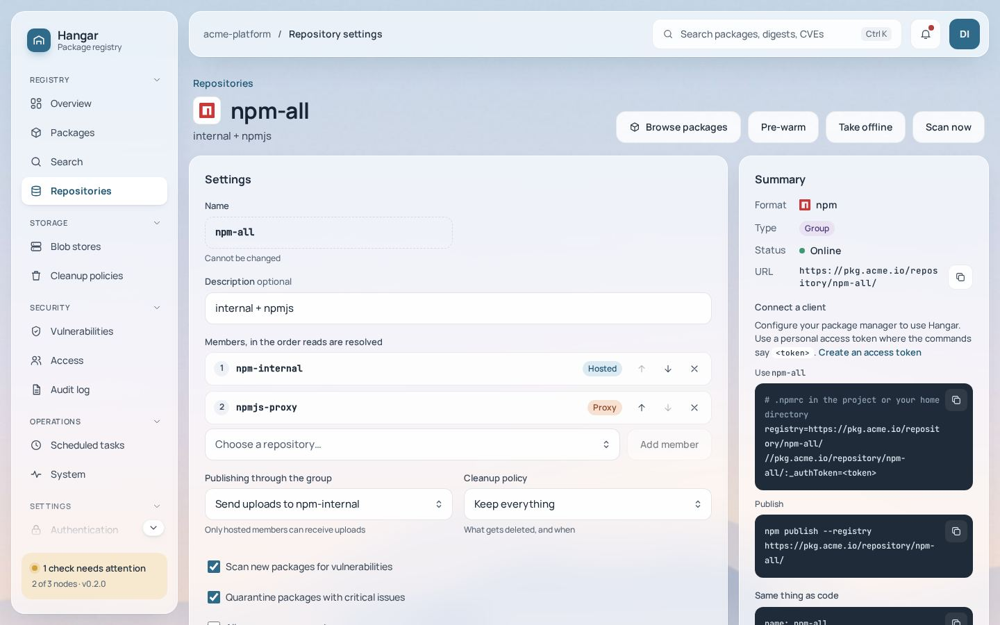
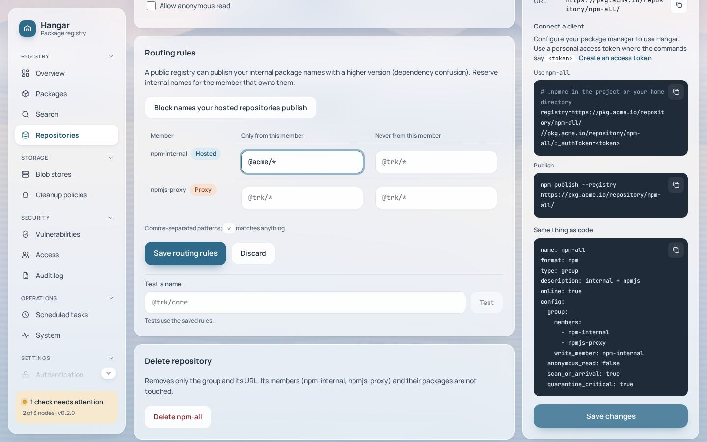
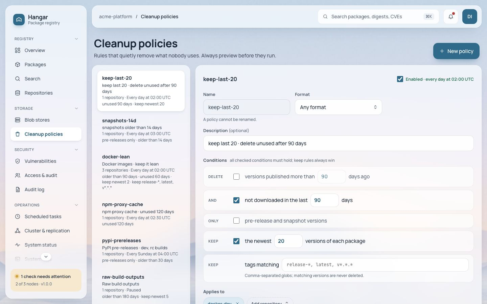
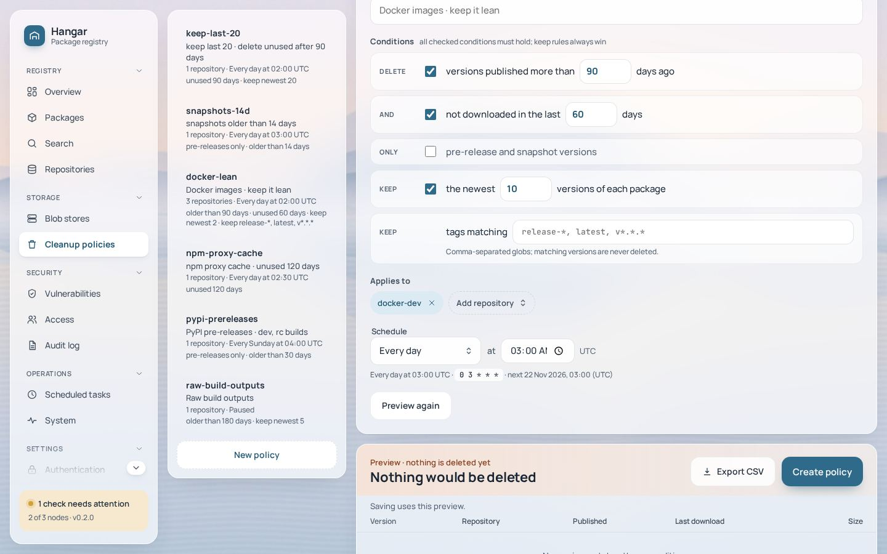

# Repositories

Create hosted, proxy and group repositories, change their settings, keep internal names safe with routing rules and clean up old versions.

## The list

Open **Repositories**. The cards count hosted, proxy and group repositories. Narrow the table with the **All**, **Hosted**, **Proxy** and **Group** tabs, the **Format** menu and **Filter by name**. Click a name to open its settings; the package icon at the end of a row browses its packages.

[Try it in the demo](/demo/#/repositories)

## Create a hosted repository

A hosted repository stores what your team publishes.

1. **Open the form**

    Click **New repository** (also on the Overview).

2. **Step 1: What will it store?**

    Pick the format: Docker, npm, Maven, PyPI, Go, Helm, NuGet, Cargo, APT, RPM or Raw.

3. **Step 2: How should it behave?**

    Pick **Hosted**.

4. **Step 3: Settings**

    Enter a **Name** (lowercase letters, numbers and dashes; it cannot be changed later) and choose the **Blob store** that keeps the files. **Description** and **Cleanup policy** are optional. Under **Security and access**, **Scan new packages for vulnerabilities** and **Quarantine packages with critical issues** are on; **Allow anonymous read** is off.

    

5. **Create it**

    Check the **Summary** on the right: format, type, URL and the configuration as YAML (`POST /api/v1/repositories` accepts the same YAML). Click **Create repository**. Its settings page opens with a note that it is ready.

[Try it in the demo](/demo/#/repositories/new?format=docker&type=hosted)

## Create a proxy repository

A proxy caches a public registry: the first request fetches a file, later ones are served from Hangar.

1. **Pick the format and Proxy**

    In **New repository**, pick for example **npm**, then **Proxy**. The name and **Remote URL** are filled in for that format (`npm-proxy`, `https://registry.npmjs.org`); change them if you like.

2. **Set the cache times**

    **Metadata cached for** is how long indexes and tag lists are reused (`24h`). **Content cached for** applies to files; `0s` keeps them forever. **Not-found cached for** remembers 404s (`10m`).

    

3. **Private remote?**

    Open **Upstream credentials and connection**. **Authentication** sends a username and password or a token, only to the remote's own host. **Outbound proxy** picks one of the proxies from [Settings → Proxies](/docs/ui/settings/). **Extra trusted certificates** takes a PEM for a private CA.

4. **Create it**

    Click **Create repository**. Point a client at it ([Connect a client](/docs/ui/connect/)) and the cache fills as builds run, or fill it ahead with a [pre-warm task](/docs/ui/tasks/).

[Try it in the demo](/demo/#/repositories/new?format=npm&type=proxy)

## Create a group

A group gives clients one URL for several repositories of the same format, usually your hosted repository plus a proxy.

1. **Pick the format and Group**

    In **New repository**, pick the format, then **Group**, and enter a name.

2. **Add members**

    Under **Members, in the order reads are resolved**, choose a repository in **Choose a repository…** and click **Add member**. Repeat, then use the arrows to put your hosted repository first.

3. **Decide where uploads go**

    **Publishing through the group** is **Read-only group** or **Send uploads to** one hosted member. Only hosted members can receive uploads.

    

4. **Create it**

    Click **Create repository**. Give clients the group's URL.

[Try it in the demo](/demo/#/repositories/new?format=npm&type=group)

## Change a repository

1. **Open its settings**

    Click the repository's name in the list.

2. **Edit and save**

    The name and format are fixed. Change the description, members, remote, cache times, cleanup policy or security options, then click **Save changes**. Leaving with unsaved edits asks first.

    

3. **Other actions**

    At the top: **Browse packages**, **Pre-warm** (proxies and groups), **Take offline** (it stops serving until you click **Bring online**), **Invalidate cache** on a proxy (asks first, then says what was dropped) and **Scan now** for formats that are scanned. **Delete repository** sits at the bottom; a group that lists the repository must drop it first. Deleting a group removes only the group and its URL, never its members or their packages.

[Try it in the demo](/demo/#/repositories/npm-all/settings)

## Routing rules

A public registry can publish one of your internal package names with a higher version (dependency confusion). Routing rules on a group keep each name on the member that owns it.

1. **Open the group**

    Open the group's settings and scroll to **Routing rules**.

2. **Reserve your names**

    For each member, fill **Names only <member> serves** or **Names <member> never serves** with comma-separated patterns; `*` matches anything, for example `@acme/*`. **Block names your hosted repositories publish** fills the rules from what you already publish.

    

3. **Save and test**

    Click **Save routing rules**. Type a package name in **Test a name** and click **Test** to see which member would answer; tests use the saved rules.

More in [Routing rules](/docs/guides/routing-rules/).

[Try it in the demo](/demo/#/repositories/npm-all/settings)

## Cleanup policies

A cleanup policy deletes versions nobody needs, on a schedule. Open **Cleanup policies** in the sidebar.

1. **Start a policy**

    Click **New policy**. Enter a **Name**, pick a **Format** (or **Any format**) and add a description.

2. **Set the conditions**

    All checked conditions must hold and keep rules always win: **delete versions published more than … days ago**, **and not downloaded in the last … days**, **only pre-release and snapshot versions**, **keep the newest … versions of each package** and **keep tags matching** (comma-separated globs such as `release-*, latest`).

3. **Choose repositories and a schedule**

    Under **Applies to**, use **Add repository**. Under **Schedule**, pick **How often** and the time in UTC.

4. **Preview, then save**

    Click **Preview**. **What would be deleted** lists exactly what the conditions select right now (**Export CSV** to share it). Saving needs a preview of the current conditions; click **Create policy**.

    

A repository can also pick its policy in its own settings (**Cleanup policy**). Freed space returns after the next blob compaction ([Scheduled tasks](/docs/ui/tasks/)).

[Try it in the demo](/demo/#/cleanup?create=true)
