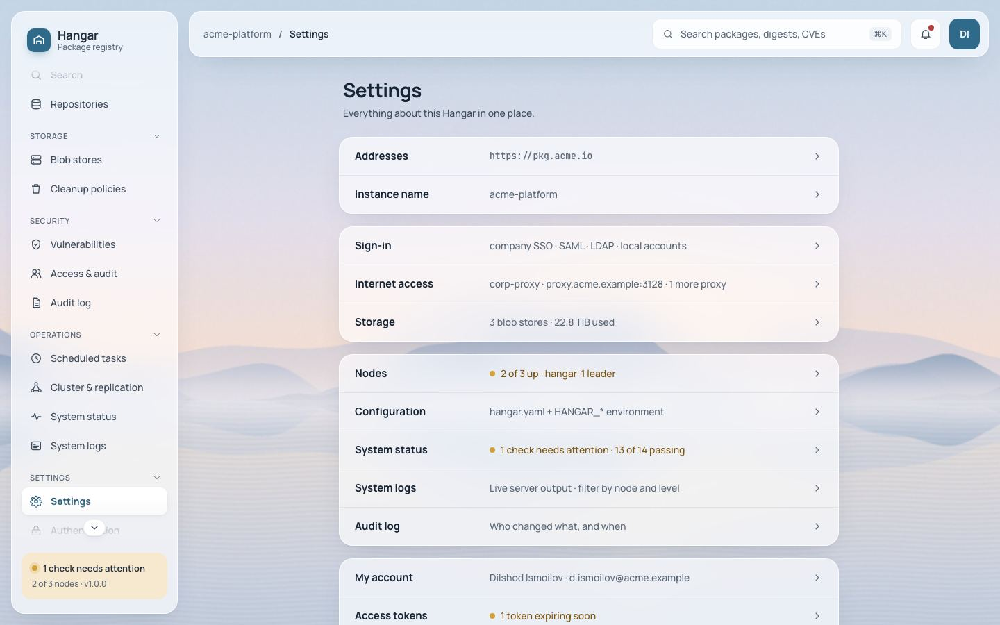
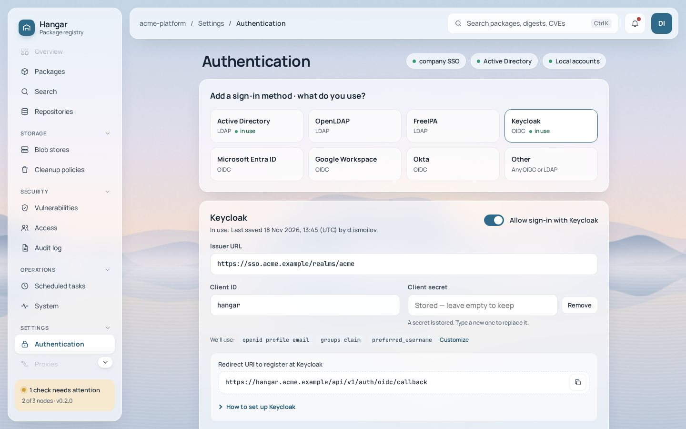
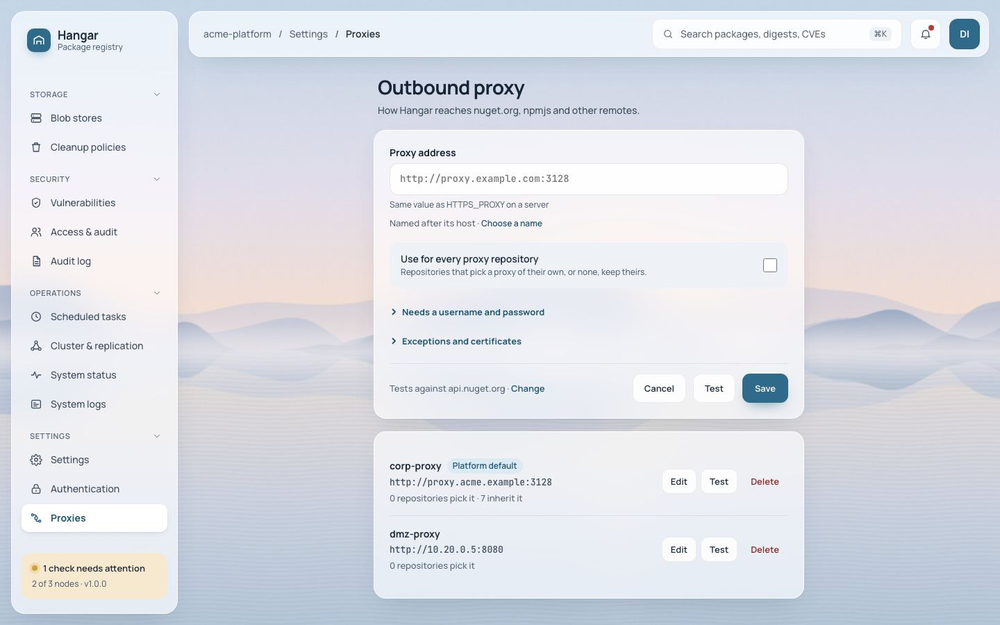
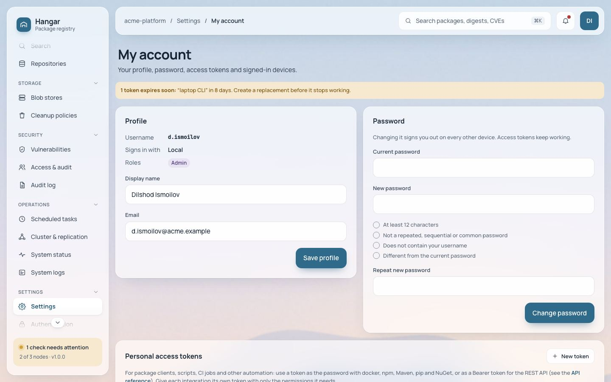

# Settings

Sign-in providers, outbound proxies, this installation and your own account.

Open **Settings**. Each row says what is set now and opens its page: addresses and instance name, sign-in, internet access, storage, nodes, configuration, status, logs, audit, your account, access tokens and the API reference.

[Try it in the demo](/demo/#/settings)

## Add a sign-in provider

1. **Pick your provider**

    Open **Settings → Authentication**. Under **Add a sign-in method · what do you use?**, pick Active Directory, OpenLDAP, FreeIPA, Keycloak, Microsoft Entra ID, Google Workspace, Okta or **Other** (any OIDC or LDAP).

2. **Fill in the connection**

    For OIDC: **Issuer URL**, **Client ID** and **Client secret**. Copy the **redirect URI** shown below them and register it at the provider; **How to set up …** walks through the provider's side. For LDAP: **Server**, **Service account** and **Password**.

    

3. **Map groups to roles**

    Open **Groups and roles** and map directory groups to Hangar roles, so people get their access when they sign in.

4. **Test and save**

    Click **Test** (LDAP asks for a username to look up), then **Save**. The switch **Allow sign-in with …** turns the provider on or off without losing its settings.

More in [Sign-in & tokens](/docs/guides/access/).

[Try it in the demo](/demo/#/settings/authentication)

## Add an outbound proxy

When your network blocks direct internet access, Hangar reaches registries through an HTTP proxy.

1. **Open Proxies**

    Open **Settings → Proxies** and click **Add another proxy**.

2. **Enter the proxy**

    Type the **Proxy address**, for example `http://proxy.example.com:3128`. Check **Use for every proxy repository** to make it the platform default. **Needs a username and password** and **Exceptions and certificates** open the rest.

    

3. **Test and save**

    Click **Test**, then **Save**. A proxy repository can pick a different proxy under **Upstream credentials and connection**.

[Try it in the demo](/demo/#/settings/proxies)

## Your account

**My account** (from the account menu or Settings) has your **Profile**, **Password** (the rules are listed as you type; changing it signs you out on every other device, and tokens keep working), **Personal access tokens** and your signed-in devices, grouped by device and address.

[Try it in the demo](/demo/#/account)
