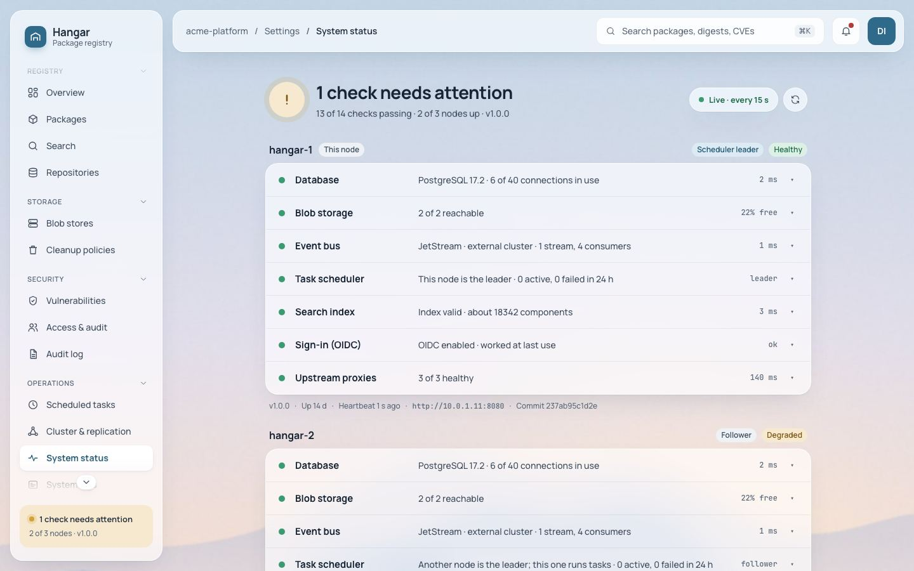
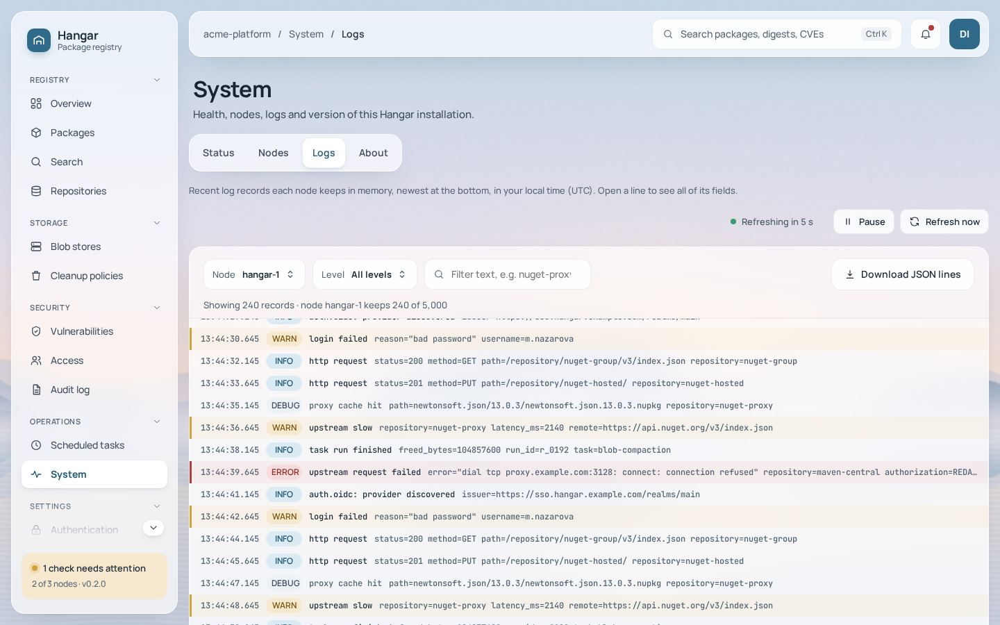
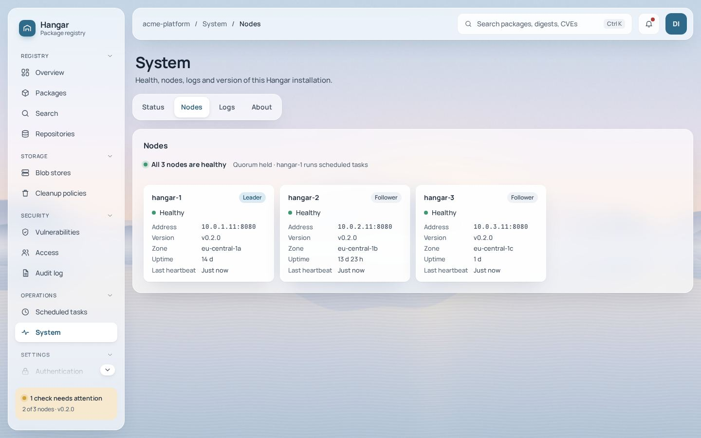
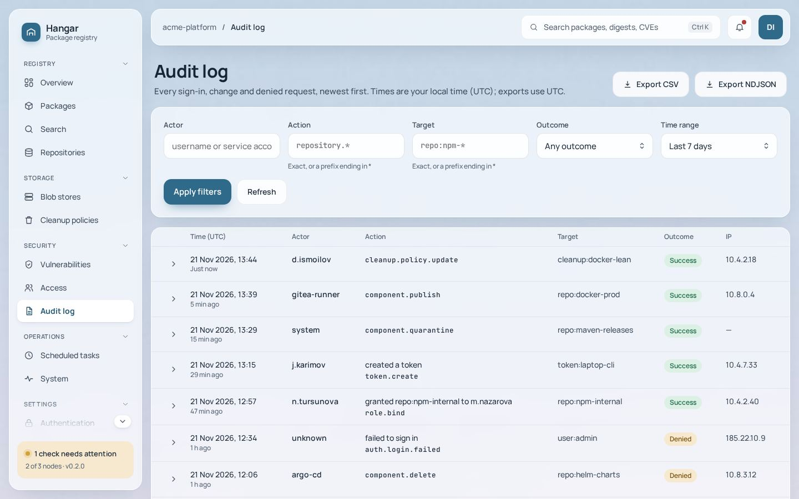

# Status, logs & audit

Is Hangar healthy, what did it just log, and who changed what.

## System status

1. **Open System status**

    The heading answers first: all checks pass, or how many need attention.

2. **Read the rows**

    Each node has one row per check: **Database**, **Blob storage**, **Event bus**, **Task scheduler**, **Search index**, **Sign-in** and **Upstream proxies**. Click a row for details and a link to where it is fixed.

    

3. **Keep it open**

    The page refreshes every 15 seconds; pause it, or click **Refresh now**.

[Try it in the demo](/demo/#/system/status)

## System logs

Recent log records that each node keeps in memory, newest at the bottom. Times are in your local time. Pick a **Node** and a **Level**, filter by text (`nuget-proxy`), and open a line to see all of its fields. **Pause** stops the refresh; **Download JSON lines** saves what is shown.

[Try it in the demo](/demo/#/system/logs)

## Cluster

The nodes serving this registry: which one leads scheduled tasks, their addresses, versions, zones, uptime and last heartbeat.

[Try it in the demo](/demo/#/cluster)

## Audit log

Every sign-in, change and denied request, newest first. Filter by **Actor**, **Action**, **Target** (exact, or a prefix ending in `*`), **Outcome** and **Time range**, then click **Apply filters**. Open a row for its details. Times are in your local time; **Export CSV** and **Export NDJSON** download what matches, with times in UTC.

[Try it in the demo](/demo/#/audit)

Metrics, alerts and probes: [Health & status](/docs/operations/monitoring/).
