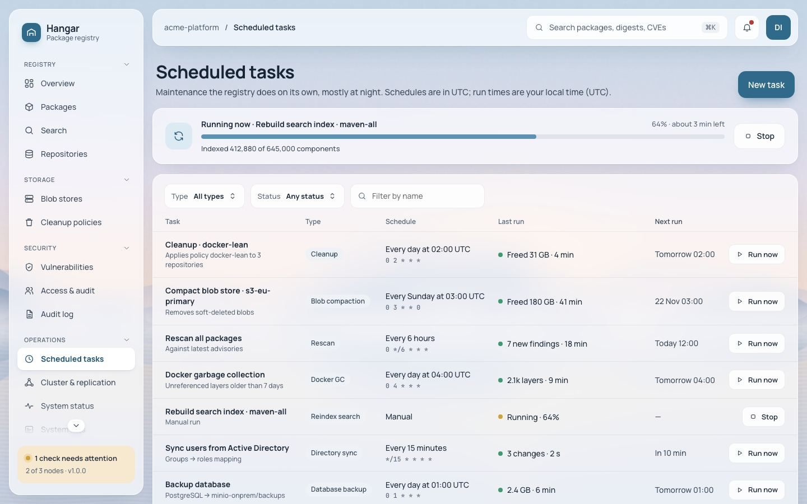
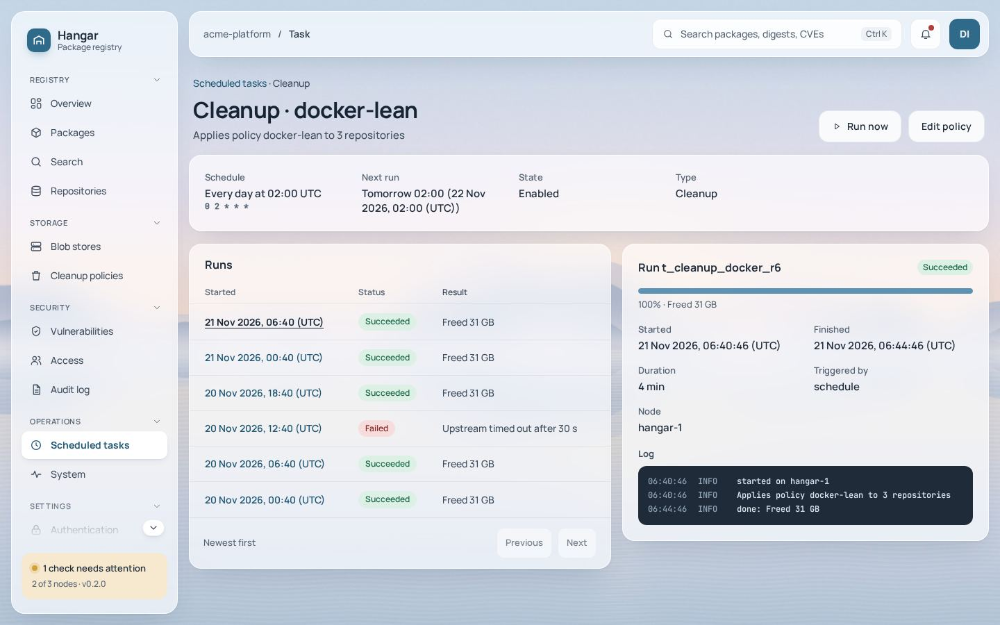
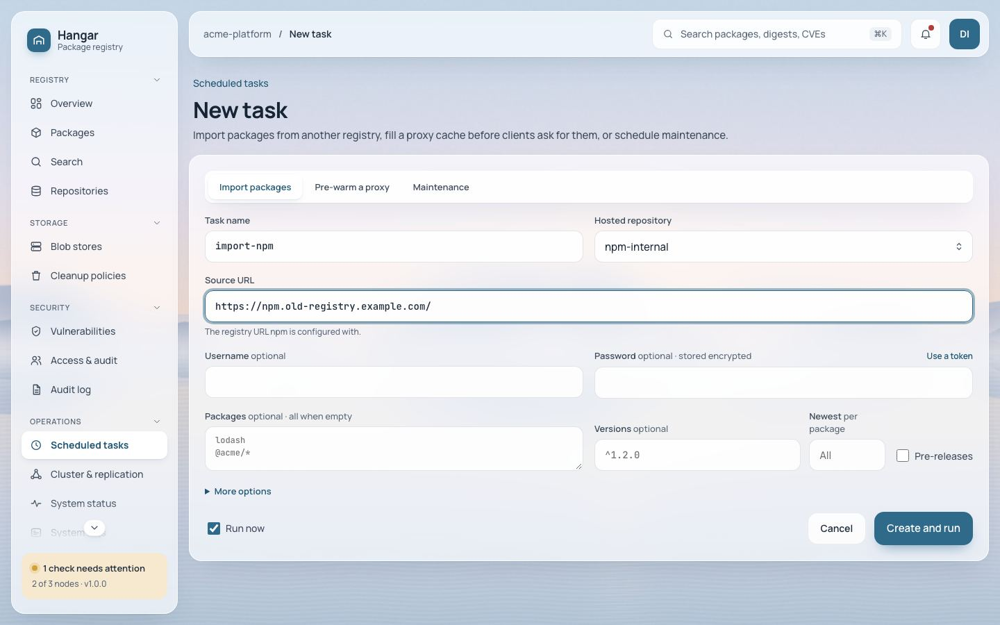
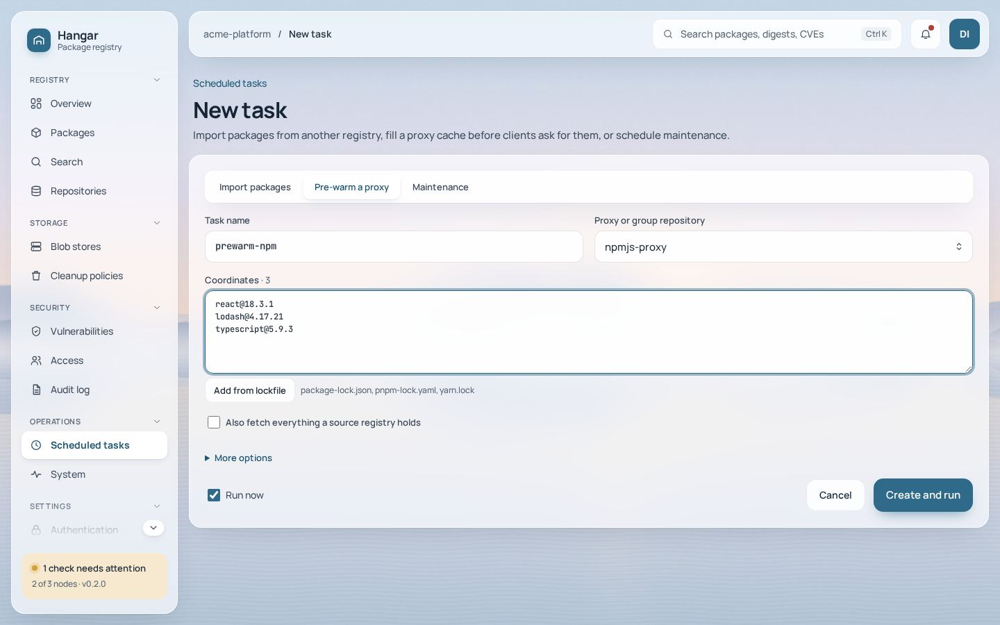

# Scheduled tasks

Maintenance that runs on its own, mostly at night, plus imports from another registry and pre-warming proxies.

## The task list

Open **Scheduled tasks**. A task that is running shows its progress at the top with **Stop**. The table lists maintenance such as cleanup, blob compaction, rescans, Docker garbage collection and search index rebuilds, with their schedule, last run and next run. Filter by **Type**, **Status** or name; **Run now** starts one at once. Schedules are in UTC; run times are shown in your local time.

[Try it in the demo](/demo/#/tasks)

Click a task to see its schedule and every run; click a run for its log. **Edit** changes the schedule (**How often**, the day and the time in UTC) and **Enabled**: a disabled task keeps its schedule but runs only with **Run now**. A cleanup task is changed through its policy (**Edit policy**). Tasks an administrator added can be deleted.

## Import packages from another registry

1. **Open the form**

    Click **New task** and keep **Import packages**.

2. **Where from, where to**

    Enter a **Task name** and pick the **Hosted repository** to import into. **Source URL** is the URL the format's clients use for the old registry. Add a username and password (or **Use a token**) if it needs one; it is stored encrypted.

3. **What to import**

    Leave **Packages** empty for everything, or list names and prefixes. **Versions** takes a range, **Newest per package** keeps only the latest few, and **Pre-releases** includes them. **More options** has a **Schedule** (**Manual only** by default), **Exclude**, and the request rate (**Requests per second**, **At once**).

    

4. **Run it**

    Keep **Run now** checked and click **Create and run**. The task page shows its progress.

[Try it in the demo](/demo/#/tasks/new)

## Pre-warm a proxy

Fill a proxy's cache before clients ask, for example before switching CI to Hangar.

1. **Open the form**

    Click **New task**, then **Pre-warm a proxy**, or **Pre-warm** in a proxy's settings.

2. **Pick the proxy**

    Enter a **Task name** and pick the **Proxy or group repository**.

3. **List what to fetch**

    Type **Coordinates**, one per line (`react@18.3.1`), or click **Add from lockfile** to read a `package-lock.json`, `pnpm-lock.yaml` or `yarn.lock`. **Also fetch everything a source registry holds** copies a whole registry instead.

    

4. **Run it**

    Click **Create and run**.

[Try it in the demo](/demo/#/tasks/new?kind=prewarm)

## Schedule maintenance

1. **Pick Maintenance**

    Click **New task**, then **Maintenance**, and enter a **Task name**.

2. **Choose the job**

    Under **Maintenance**, pick **Blob compaction** (frees space held by deleted files) or Docker garbage collection, and the **Blob store** it applies to.

3. **Schedule it**

    Pick **How often**; **Manual only** runs only when someone presses **Run now**. Click **Create task**.

The full migration path is in [Move to Hangar](/docs/guides/migrate/).
