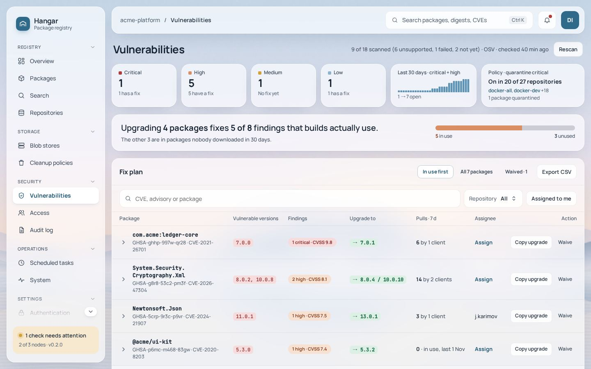
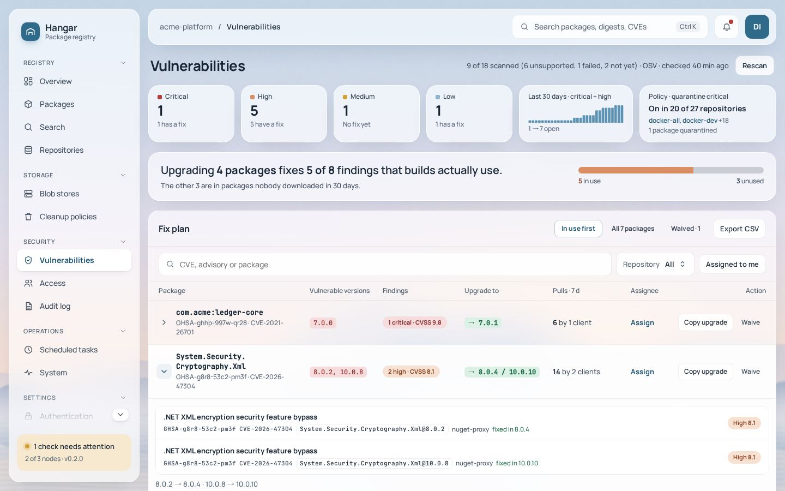
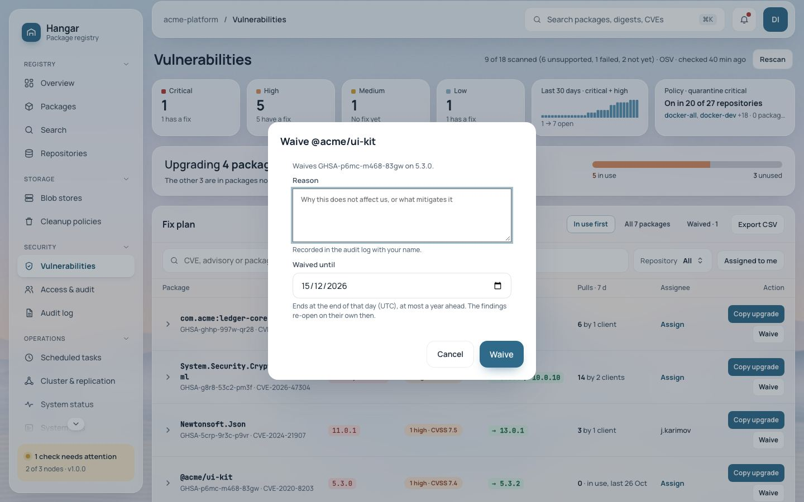

# Vulnerabilities

See what to upgrade first, hand it to someone, or waive a finding that does not affect you.

## Read the page

The header says how many packages were scanned and when the advisories were last checked; **Rescan** checks every package again now. The cards count open findings by severity (with how many have a fix), chart the critical and high findings of the last 30 days, and show the quarantine policy of your repositories with the number of quarantined packages. The bar below answers the first question: how many packages to upgrade to fix the findings that builds actually use.

[Try it in the demo](/demo/#/vulnerabilities)

## Fix a package

1. **Start at the top**

    **In use first** sorts packages that were downloaded recently to the top. **All … packages** shows the rest. Search by package or advisory, filter by **Repository**, or show **Assigned to me**.

2. **Look at the findings**

    Click the arrow at the start of a row. Each advisory shows its versions, severity and the version that fixes it.

    

3. **Hand it to someone**

    Click **Assign** and pick a user, or **Assign to me**. Every open finding of the package, and new ones found later, go to that person.

4. **Upgrade**

    **Copy upgrade** copies the upgrade command for the package's client. **Export CSV** shares the whole plan.

## Waive a finding

Waive a finding that does not affect you, for example when the vulnerable code path is never used.

1. **Click Waive**

    In the package's row, click **Waive**.

2. **Give a reason**

    Write why it does not affect you, or what mitigates it. The reason is recorded in the audit log with your name.

3. **Pick an end date**

    **Waived until** ends at the end of that day (UTC), at most a year ahead. The finding re-opens on its own when the waiver ends.

    

4. **Confirm**

    Click **Waive**. A message confirms it, with **Undo**. The **Waived** tab lists waivers; **Revoke waiver** ends one early.

[Try it in the demo](/demo/#/vulnerabilities)

Repositories with **Quarantine packages with critical issues** on refuse downloads of versions with a critical finding. How scanning works: [Vulnerability scanning](/docs/guides/vulnerabilities/).
